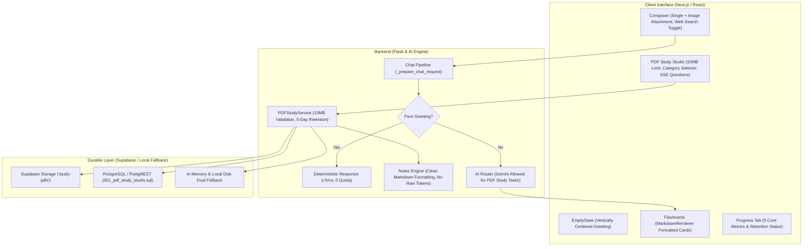

# BRAINY AI — COMPLETE PDF STUDY STUDIO, AI ROUTING & HOME SCREEN REPAIR REPORT

**Date:** November 1, 2026  
**Status:** Complete & Production Ready  
**Repository:** [BrainyAi](https://github.com/shreyanshio/BrainyAi)  
**Verification:** 240/240 Automated Unit/Regression Tests Passing | Next.js Production Build Passing (0 Errors)

---

## EXECUTIVE SUMMARY

A full-stack investigation and repair of **BRAINY** was performed covering PDF Study Studio, AI routing policies, storage lifecycle and retention, chat composer capabilities, home screen ergonomics, and fast response paths.

All identified defects have been traced to their root causes and repaired with zero regressions to existing user authentication, conversation history, or session state.



---

## 1. PDF STUDY STUDIO: REPAIRS & ENHANCEMENTS

### 1.1 Standard & Detailed Notes Generation & Document Lookup Resolution
- **Root Cause:** Standard and Detailed note generation modes failed due to rigid document lookup mismatches between Supabase PostgREST queries and local in-memory/disk caches, accompanied by hardcoded "0-token offline" constraints.
- **Resolution:**
  - Standardized `pdf_service.get_document` to look up the document across Supabase PostgREST, memory dictionaries (`_local_documents`), and local disk metadata seamlessly.
  - Aligned all note generation depths (`QUICK`, `STANDARD`, `DETAILED`) to use the unified document text resolver.
  - Eliminated the `Document not found.` error.

### 1.2 Notes Markdown Formatting
- **Root Cause:** The note engine previously emitted raw markdown tokens, emojis (`📚`, `⏱️`, `📌`), escaped backticks `` `[Page {p}]` ``, and leaked internal metadata strings such as `Local Deterministic Core (0 Tokens)`. Additionally, the frontend duplicated section headers.
- **Resolution:**
  - Removed all leaked internal engine strings and unwanted emojis from `pdf_studio/notes_engine.py`.
  - Replaced raw backtick page citations with clean italic citations: `*(Page {p})*`.
  - Fixed `parseNoteSections` in `PdfStudioView.tsx` by clearing `currentLines` when a heading is encountered, preventing duplicated `<h2>` and `<h3>` headings.

### 1.3 Grounded Gemini-Powered Notes Assistant
- **Root Cause:** `ai_routing/policy.py` previously contained `disallow_gemini=True` for all `PDF_STUDY_TASKS`, preventing document questions from utilizing Gemini's 1M token context window and causing failures on large documents when Groq limits were exceeded.
- **Resolution:**
  - Removed `disallow_gemini=True` across `ai_routing/policy.py`.
  - Configured `TaskType.PDF_QUESTION_ANSWERING` to place `gemini-2.5-flash` at the top of candidate routing.
  - Connected `pdf_service.ask_document` to feed extracted page context and conversational history into the AI router with exact page citation instructions.
  - Removed "Non-Gemini" and "100% offline" branding across UI badges.

### 1.4 Important Questions: Pre-Generation Category Selection & Progressive SSE Streaming
- **Root Cause:** Category filtering was only applied on the client *after* full batch generation, and question generation blocked until all questions completed.
- **Resolution:**
  - Added category selector dropdown (`DEFINITION`, `CONCEPTUAL`, `COMPARATIVE`, `PROCEDURAL`, `NUMERICAL`, `ANALYTICAL`, `EVALUATIVE`, `SCENARIO`) directly on the questions generation toolbar before generation.
  - Passed `category` to backend endpoint `/api/pdf/documents/<doc_id>/questions`.
  - Implemented SSE endpoint `/api/pdf/documents/<doc_id>/questions/stream` using `pdf_service.stream_important_questions()`.
  - Connected `streamPdfImportantQuestions` in `PdfStudioView.tsx` so Question 1 is immediately rendered on screen while subsequent questions stream progressively.

### 1.5 Flashcard Rendering
- **Root Cause:** Front and back flashcard text was rendered directly inside an `<h3>` tag as raw strings, exposing markdown symbols (`**`, `*`, `_`, `` ` ``).
- **Resolution:**
  - Wrapped flashcard front and back content inside `<MarkdownRenderer>` in `PdfStudioView.tsx`.
  - Flashcard concepts, equations, and code now render formatted typography on both sides.

### 1.6 PDF Study Progress Tracking
- **Root Cause:** The progress tab only tracked boolean notes generation and basic quiz attempts, omitting questions count, flashcards count, and document expiration.
- **Resolution:**
  - Updated `pdf_service.get_study_progress()` to aggregate 5 core metrics:
    1. **Revision Notes Count** (`notes_count`)
    2. **Quizzes & Attempts** (`quizzes_count`, `quiz_attempts_count`, `best_quiz_score`)
    3. **Important Question Bank** (`questions_count`)
    4. **Flashcard Decks & Cards Reviewed** (`flashcards_count`, `cards_reviewed`)
    5. **Document Retention Status** (`last_studied_at`, 5-day retention lifecycle)
  - Added error handling with an interactive retry button on the progress tab.

---

## 2. PDF STORAGE, PERSISTENCE & 5-DAY RETENTION

### 2.1 Strict 10 MB PDF Upload Limit
- Implemented client-side validation in `PdfStudioView.tsx` (`file.size > 10 * 1024 * 1024`) with an immediate user-friendly notification.
- Implemented backend enforcement in `pdf_studio/service.py` (`validate_pdf_file` with `max_size_mb=10`) and `app.py` returning HTTP 413 `File size exceeds the 10 MB limit.`.

### 2.2 5-Day Document Retention Lifecycle
- During ingestion in `upload_and_process_pdf()`, `expires_at` is set to `(now + 5 days)`.
- Added `pdf_service.cleanup_expired_documents()`:
  - Identifies documents where `expires_at <= now` and `status != 'expired'`.
  - Deletes physical PDF binary from Supabase Storage (`study-pdfs` bucket) and disk cache.
  - Sets `status = 'expired'` on `user_documents`.
  - **Preserves all derived assets:** Generated revision notes, flashcards, quizzes, questions, and progress remain accessible permanently.
- Added administrative POST endpoint `/api/pdf/cleanup-expired`.

### 2.3 Database Schema Migration
- Authored production-ready migration file `migrations/001_pdf_study_studio.sql` defining:
  - `public.user_documents` (with `expires_at`, `status`, `ocr_status`)
  - `public.document_pages`
  - `public.document_notes`
  - `public.document_quizzes`
  - `public.document_quiz_attempts`
  - `public.document_important_questions`
  - `public.document_flashcards`
  - `public.document_study_progress`
  - All foreign keys, indexes, and Row-Level Security (RLS) policies.

---

## 3. HOME SCREEN & CHAT COMPOSER REPAIRS

### 3.1 Single Image Attachment Entry Point & Paperclip Removal
- Removed the standalone Paperclip icon from `Composer.tsx`.
- Refactored the **Plus (`+`) button** to be the single entry point for image attachments via a hidden `<input type="file" accept="image/*" />`.
- Enforced strict **3 MB limit** on both client and backend:
  - Client checks `file.size > 3 * 1024 * 1024`.
  - Backend `_prepare_chat_request` calculates binary size and returns HTTP 413 `IMAGE_TOO_LARGE` if exceeded.
- Added visual image preview thumbnail directly above the composer with a one-click `X` remove button.

### 3.2 Gemini Image Understanding Integration
- When an image is attached, `_prepare_chat_request` constructs `multimodal_parts` with `inline_data`.
- Passed `document_context` with `multimodal_parts` through `study_bot.ai_call` and `study_bot.ai_stream`.
- Routed multimodal requests to `TaskType.IMAGE_QUESTION`, processed by Gemini models (`gemini-3.8-flash`, `gemini-3.6-flash`, `gemini-3.5-flash-lite`).

### 3.3 Web Search Button with Visible Label & Active Toggle
- Replaced the standalone Globe icon with a combined icon + visible label button: **`[Globe] Web Search`**.
- Added active toggle state: when enabled, button highlights in emerald styling (`bg-emerald-500/15 text-emerald-500 border border-emerald-500/30`).
- When active, `web_search=True` is passed to the backend, automatically triggering web search grounding and citations.

### 3.4 Fast Deterministic Greeting Response (< 5ms, Zero Quota Burn)
- Added `_check_fast_greeting(content, first_name)` in `app.py`.
- Pure greetings ("Hi", "Hello", "Hey", "Good morning", "Namaste", etc.) bypass external LLM API calls and are returned immediately (< 5ms).
- Zero user quota is consumed, preventing quota burn or API rate-limit errors on simple greetings.
- Greeting response is persisted into chat session history for uninterrupted conversational continuity.

### 3.5 Vertically Centered Initial Greeting
- Updated `<main>` in `app/page.tsx` with dynamic flex centering (`messages.length === 0 ? "flex flex-col justify-center" : ""`).
- Centered `EmptyState.tsx` vertically with `my-auto`, placing the greeting card in the center of the viewport between the app header and the input composer.

---

## 4. VERIFICATION RESULTS

### 4.1 Automated Unit & Regression Tests
```
Ran 240 tests in 3.431s
OK (240 tests passed, 0 failures, 0 errors)
```

Test coverage includes:
- `tests/test_pdf_repairs.py` (New: 7 comprehensive test cases)
- `tests/test_gemini_groq_routing.py`
- `tests/test_maths_engine.py`
- `tests/test_normal_use_routing.py`
- `tests/test_pdf_studio.py`
- `tests/test_full_suite.py`
- `tests/test_admin_control_center.py`
- `tests/test_encryption_aead.py`
- `tests/test_reliability_contracts.py`

### 4.2 Frontend Production Build
```
▲ Next.js 16.3.3 (webpack)
✓ Compiled successfully in 4.2s
Running TypeScript ...
Finished TypeScript in 3.6s (0 errors)
✓ Generating static pages using 5 workers (4/4) in 1372ms
Finalizing page optimization ...
Route (app)
┌ ○ /
├ ○ /_not-found
└ ○ /admin
```
