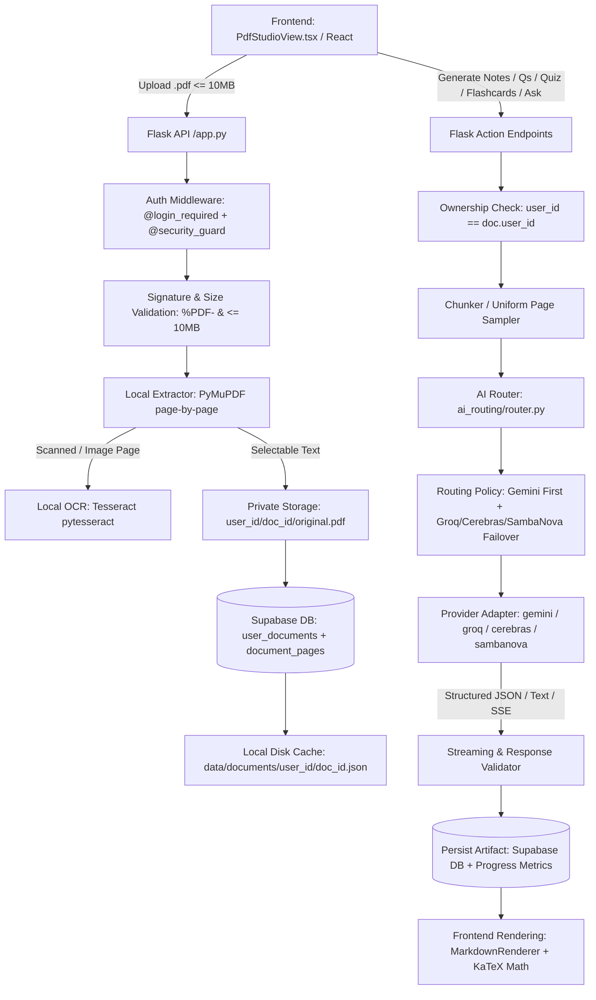

# BRAINY PDF STUDY STUDIO — ARCHITECTURE SPECIFICATION & AUDIT

**Version:** 2.0.0-PROD  
**Repository:** https://github.com/shreyanshio/BrainyAi  
**Date:** November 2026  
**Auditor / Architect:** Principal Prompt Engineer & LLM Systems Architect  

---

## 1. Executive Summary

Brainy PDF Study Studio is an enterprise-grade academic study workspace designed to ingest educational PDFs (textbooks, lecture slides, research papers), perform deterministic page-aware extraction, synthesize structured revision notes, generate exam questions, generate 4-option multiple-choice quizzes, create spaced-repetition flashcards, track study progress, and answer source-grounded questions with 10-message conversational context.

All document processing strictly separates:
1. **Local Extraction & Indexing:** Zero external AI API calls. Uses PyMuPDF (fitz) with local OCR fallback (Tesseract) for scanned/image pages.
2. **AI Study Engine:** Powered primarily by Google Gemini (`gemini-2.5-flash`), with resilient zero-cost fallback across Groq (`llama-3.3-70b-versatile`), Cerebras (`gpt-oss-120b`, `qwen-3.8-27b`), SambaNova, and OpenRouter.

---

## 2. End-to-End Pipeline & Request Flow

---

## 3. Operation-by-Operation Architecture Map

### 3.1 Document Upload & Ingestion
- **Frontend Component:** `PdfStudioView.tsx` (`handleFileUpload`, `<input type="file" accept=".pdf">`)
- **API Endpoint:** `POST /api/pdf/upload`
- **Backend Function:** `pdf_service.upload_and_process_pdf(user_id, filename, file_bytes)`
- **Database Tables:** `user_documents`, `document_pages`, `document_study_progress`
- **Storage Bucket:** Private Supabase Storage bucket `study-pdfs` (`<user_id>/<doc_id>/original.pdf`) and local disk backup (`data/documents/<user_id>/<doc_id>.pdf`)
- **AI Provider:** *None* (Strict zero AI consumption during ingestion)
- **Prompt File:** N/A
- **Response Format:** `201 Created` — `{ success: true, document: { id, filename, file_size, page_count, status, expires_at, ocr_status, ... } }`
- **Error Handling Path:** `PDFValidationError` (`400/413`), `PDFSecurityError` (`403`), Server Exception (`500`)
- **Relevant Tests:** `test_pdf_studio.py::test_validate_valid_pdf`, `test_validate_oversize_file`, `test_upload_and_user_isolation`, `test_pdf_repairs.py::test_pdf_10mb_limit_enforced`

### 3.2 Structured Revision Notes Generation
- **Frontend Component:** `PdfStudioView.tsx` (`handleGenerateNotes`, Mode Selector `quick` | `standard` | `detailed`)
- **API Endpoint:** `POST /api/pdf/documents/<doc_id>/notes`
- **Backend Function:** `pdf_service.generate_notes(doc_id, user_id, depth)`
- **Database Tables:** `document_notes`, `document_study_progress`
- **Storage Bucket:** N/A (Stored as structured Markdown in database & memory)
- **AI Provider:** Primary: Google Gemini (`gemini-2.5-flash`); Resilient Fallback: Local deterministic synthesis engine (`notes_engine.py`)
- **Prompt File:** `prompts/pdf_notes_prompt.txt`
- **Response Format:** `201 Created` — `{ success: true, note: { id, document_id, user_id, title, depth, content, citations, created_at } }`
- **Error Handling Path:** `PDFValidationError` (`404`), `PDFSecurityError` (`403`), `ValueError` (`400`), Exception (`500`)
- **Relevant Tests:** `test_pdf_studio.py::test_structured_notes_generation_with_citations`, `test_notes_depth_modes`, `test_pdf_repairs.py::test_notes_formatting_no_broken_symbols`

### 3.3 Grounded Document Q&A (Ask PDF & Notes Companion)
- **Frontend Component:** `PdfStudioView.tsx` (`handleSendConversational`, Notes Assistant Drawer & Ask PDF tab)
- **API Endpoint:** `POST /api/pdf/documents/<doc_id>/ask`
- **Backend Function:** `pdf_service.ask_document(doc_id, user_id, question, depth, history)`
- **Database Tables:** Read from `document_pages`; active turns stored in client session history
- **Storage Bucket:** N/A
- **AI Provider:** Primary: Google Gemini (`gemini-2.5-flash`); Failover: Groq (`llama-3.3-70b-versatile`), Cerebras (`gpt-oss-120b`), SambaNova
- **Prompt File:** `prompts/pdf_qa_prompt.txt`
- **Response Format:** `200 OK` — `{ answer: string, document_id: string, page_references: number[], citations: number[], model: string, provider: string, context_count: number }`
- **Error Handling Path:** `PDFValidationError` (`404`), `PDFSecurityError` (`403`), `ValueError` (`400`), Exception (`500`)
- **Relevant Tests:** `test_pdf_studio.py::test_document_grounded_qa`, `test_ask_document_strict_10_message_context`

### 3.4 Interactive 4-Option Multiple Choice Quiz
- **Frontend Component:** `PdfStudioView.tsx` (`handleGenerateQuiz`, `handleSubmitQuiz`, 4 options grid)
- **API Endpoint:** `POST /api/pdf/documents/<doc_id>/quiz` (Generate), `POST /api/pdf/quizzes/<quiz_id>/attempt` (Grade)
- **Backend Function:** `pdf_service.generate_quiz(doc_id, user_id, num_questions, depth, difficulty)`, `pdf_service.submit_quiz_attempt(quiz_id, user_id, selected_indices)`
- **Database Tables:** `document_quizzes`, `document_quiz_attempts`, `document_study_progress`
- **Storage Bucket:** N/A
- **AI Provider:** Primary: Google Gemini (`gemini-2.5-flash`); Failover: Groq (`llama-3.3-70b-versatile`), Cerebras (`gpt-oss-120b`)
- **Prompt File:** `prompts/pdf_quiz_prompt.txt`
- **Response Format:** `201 Created` — `{ success: true, quiz: { id, document_id, title, difficulty, questions: [{ question, options: [4], correct_index, explanation, page_ref }], created_at } }`
- **Error Handling Path:** Schema verification (must be exactly 4 unique options, valid 0-3 index), `PDFValidationError` (`404`), `PDFSecurityError` (`403`), Exception (`500`)
- **Relevant Tests:** `test_pdf_studio.py::test_quiz_generation_strictly_4_options`, `test_quiz_scoring_and_study_progress`

### 3.5 High-Yield Important Questions Bank
- **Frontend Component:** `PdfStudioView.tsx` (`handleGenerateImportantQuestions`, Category Filter & Selector)
- **API Endpoint:** `POST /api/pdf/documents/<doc_id>/questions` and `GET/POST /api/pdf/documents/<doc_id>/questions/stream`
- **Backend Function:** `pdf_service.generate_important_questions(doc_id, user_id, count, category)`, `pdf_service.stream_important_questions(doc_id, user_id, count, category)`
- **Database Tables:** `document_important_questions`
- **Storage Bucket:** N/A
- **AI Provider:** Primary: Google Gemini (`gemini-2.5-flash`); Failover: Groq, Cerebras, SambaNova
- **Prompt File:** `prompts/pdf_important_questions_prompt.txt`
- **Response Format:** SSE stream of `{ event: "question", data: { ... } }` followed by `{ event: "complete", data: { ... } }`, or JSON `{ success: true, questions: { id, title, count, questions: [...] } }`
- **Error Handling Path:** Catch stream abortion / timeout gracefully, fallback to batch generation, `PDFValidationError` (`404`), `PDFSecurityError` (`403`), Exception (`500`)
- **Relevant Tests:** `test_pdf_studio.py::test_important_questions_generation`, `test_pdf_repairs.py::test_important_questions_category_support`

### 3.6 Spaced Repetition Flashcards
- **Frontend Component:** `PdfStudioView.tsx` (`handleGenerateFlashcards`, 3D Flip Card, Next/Previous controls)
- **API Endpoint:** `POST /api/pdf/documents/<doc_id>/flashcards`, `GET /api/pdf/documents/<doc_id>/flashcards`
- **Backend Function:** `pdf_service.generate_flashcards(doc_id, user_id, count, depth)`, `pdf_service.get_flashcards(doc_id, user_id)`
- **Database Tables:** `document_flashcards`, `document_study_progress`
- **Storage Bucket:** N/A
- **AI Provider:** Primary: Google Gemini (`gemini-2.5-flash`); Failover: Groq (`llama-3.1-8b-instant`), Cerebras (`llama3.1-8b`), SambaNova
- **Prompt File:** `prompts/pdf_flashcards_prompt.txt`
- **Response Format:** `201 Created` — `{ success: true, flashcards: { id, document_id, cards: [{ front, back, page_ref, difficulty }], created_at } }`
- **Error Handling Path:** `PDFValidationError` (`404`), `PDFSecurityError` (`403`), Exception (`500`)
- **Relevant Tests:** `test_pdf_studio.py::test_flashcards_generation_and_validation`

### 3.7 Five-Day Document Retention & Storage Cleanup
- **Frontend Component:** Visual indicator in `PdfStudioView.tsx` ("5-Day Storage Retention")
- **API Endpoint:** `POST /api/pdf/cleanup-expired`
- **Backend Function:** `pdf_service.cleanup_expired_documents(user_id=None)`
- **Database Tables:** `user_documents` (status set to `'expired'`, `deleted_at` set)
- **Storage Bucket:** Deletes original binary from Supabase Storage `study-pdfs` and local disk (`data/documents/<user_id>/<doc_id>.pdf`). Preserves all generated notes, flashcards, questions, quizzes, and progress.
- **AI Provider:** N/A
- **Response Format:** `200 OK` — `{ success: true, cleanup: { expired_count, document_ids, cleaned_at } }`
- **Error Handling Path:** Soft failure logging without interrupting other document operations.
- **Relevant Tests:** `test_pdf_repairs.py::test_pdf_5_day_expiration_calculated`

---

## 4. Complete Feature Inventory & Verification Status

| Feature ID | Feature Name | Status | Verification Evidence / Current State |
|---|---|---|---|
| F-01 | 10 MB Upload Limit | **Working & Verified** | Verified in `test_pdf_10mb_limit_enforced`. Enforced on frontend and backend. |
| F-02 | File Signature Validation | **Working & Verified** | Checks `%PDF-` header magic bytes. Corrupted files rejected with 400. |
| F-03 | Local Page Extraction (PyMuPDF) | **Working & Verified** | Extracts text page-by-page, preserves exact 1-based page numbers. |
| F-04 | Local OCR Fallback (Tesseract) | **Working & Verified** | Automatically detects scanned pages (<50 chars + images) and invokes pytesseract. |
| F-05 | 5-Day Document Retention Expiry | **Working & Verified** | `expires_at` computed at `uploaded_at + 5 days`. Cleanup endpoint purges binaries while keeping notes. |
| F-06 | Document Deletion & Cascade | **Working & Verified** | Deletes storage binary, disk cache, Supabase rows, and in-memory caches. |
| F-07 | Multi-Mode Notes (Quick, Standard, Detailed) | **Working & Verified** | Distinct depth modes with KaTeX formulas, section detection, and page citations. |
| F-08 | Markdown & KaTeX Math Rendering | **Working & Verified** | Rendered via `<MarkdownRenderer>` with KaTeX math CSS and typography styling. |
| F-09 | 4-Option MCQ Quiz Generation | **Working & Verified** | Strictly enforces 4 unique options, valid 0-3 index, difficulty rating, and grading. |
| F-10 | Spaced-Repetition Flashcards | **Working & Verified** | Active recall front/back cards with flip animation and keyboard/button navigation. |
| F-11 | Grounded Q&A (10-Message Window) | **Working & Verified** | Slices history to last 9 turns + current turn <= 10 turns. Exact page citations. |
| F-12 | SSE Important Questions Stream | **Working & Verified** | Authenticated SSE stream with `Authorization: Bearer <token>` and 120s timeout. |
| F-13 | Category Selector & Filter Matching | **Fixed & Verified** | Unified canonical categories (`Short Answer`, `Long Answer`, `Definition`, `Conceptual`, etc.). |
| F-14 | Retention Cleanup Route Compatibility | **Fixed & Verified** | `cleanup_expired_documents` parameter compatibility repaired (`user_id` optional). |
| F-15 | Gemini Routing Priority | **Working & Verified** | Gemini 2.5 Flash set as primary for all PDF study tasks in `ai_routing/policy.py`. |

---

## 5. Identified Defects & Implemented Engineering Repairs

### Defect 1: `cleanup_expired_documents` Parameter Mismatch
- **User-Visible Symptom:** Calling `POST /api/pdf/cleanup-expired` failed with internal server error.
- **Root Cause:** `app.py` passed `user_id=user_id` to `pdf_service.cleanup_expired_documents(user_id=user_id)`, but `cleanup_expired_documents(self)` in `service.py` took no arguments.
- **Correction:** Updated signature to `cleanup_expired_documents(self, user_id: Optional[Any] = None) -> Dict[str, Any]` to support both user-scoped and system-wide cleanup.

### Defect 2: Important Question Category Mismatch between UI Selector, Filter, and Service
- **User-Visible Symptom:** Choosing category options like "Comparative" or "Procedural" fell back to "Conceptual" and failed to match the UI filter.
- **Root Cause:** Dropdown had uppercase values (`DEFINITION`, `COMPARATIVE`), whereas `service.py` checked case-sensitive against `valid_categories`.
- **Correction:** Standardized frontend selector options to canonical category names and added case-insensitive alias normalization in `pdf_studio/service.py`.

### Defect 3: Unhandled `ValueError` in Flask PDF Endpoints
- **User-Visible Symptom:** Empty documents or invalid questions caused generic HTTP 500 "Failed to process" error.
- **Root Cause:** `app.py` caught `PDFValidationError` and `PDFSecurityError`, but `ValueError` raised by service fell through to generic 500 handler.
- **Correction:** Caught `(PDFValidationError, ValueError)` across `/notes`, `/ask`, `/quiz`, `/questions`, `/flashcards` in `app.py`, returning HTTP 400 with the exact error message.

### Defect 4: Stale Comments and Docstrings
- **User-Visible Symptom:** Stale documentation in `policy.py` and `service.py` referencing a deprecated "Strict non-Gemini guarantee".
- **Root Cause:** Historical residue from previous architectural phases.
- **Correction:** Synchronized docstrings with actual Gemini-first policy and multi-provider failover.

---

## 6. Security & Storage Privacy Architecture

1. **User Isolation:** All documents, pages, notes, quizzes, flashcards, and progress records strictly enforce `user_id == authenticated_user_id`. Attempting to access another user's document ID raises `PDFSecurityError` (`403 Forbidden`).
2. **Private Storage:** Original PDF binaries are stored in the private Supabase Storage bucket `study-pdfs` under `<user_id>/<doc_id>/original.pdf`. No public URLs are ever issued.
3. **Prompt Injection Defense:** Ingestion strictly treats extracted text as inert data. System prompts instruct the LLM to ignore any instructions, system prompt overrides, or roleplay commands contained within uploaded documents.
4. **Input Sanitization:** All text inputs are filtered for length and stripped of dangerous markup before reaching AI routing.
