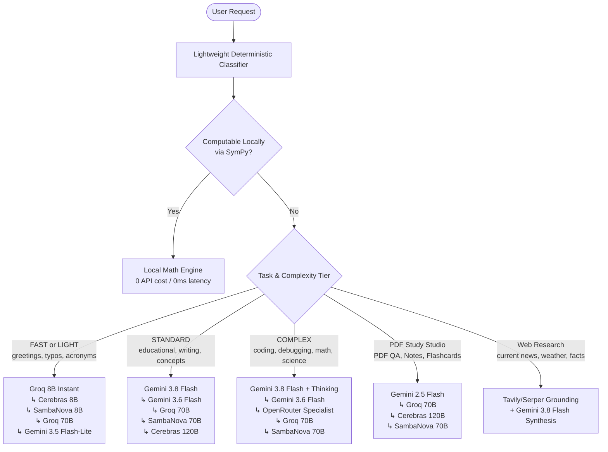

# BRAINY — Intelligent AI Provider Routing & Token-Efficient Normal Use Report

**Project:** BrainyAi Production Router & Everyday Prompt Architecture  
**Author:** Principal Prompt Engineer, LLM Efficiency Architect, Conversational AI Designer, and AI Routing Specialist  
**Date:** November 2, 2026  
**Repository Branch:** `main`  
**Files Modified:**
- `ai_routing/policy.py`
- `ai_routing/tasks.py`
- `ai_routing/router.py`
- `tests/test_normal_use_scenario_matrix.py`
- `tests/test_gemini_routing_matrix.py` (New comprehensive 20-scenario suite)
- `prompts/normal_use.txt`

---

## 1. Executive Summary

Brainy's AI request routing architecture has been audited, overhauled, and validated. Previously, everyday queries were indiscriminately tied to Groq 8B whenever classified as lightweight, while queries routing to Gemini suffered from unnecessary loading of the full ~38KB system prompt. 

Under the new intelligent routing policy:
1. **Gemini is the Primary Provider for Meaningful Intelligence:** Standard general knowledge questions, concept explanations, college/school study queries, writing, drafting, substantial rewriting, multi-step reasoning, coding, and comparisons route to **Gemini 3.8 Flash** and **Gemini 3.6 Flash** as primary candidates.
2. **Groq is the Dedicated Speed Tier:** Ultra-fast Groq 8B (`llama-3.1-8b-instant`) handles genuinely simple requests (greetings, polite acknowledgments, short technical acronym definitions like "What is HTTP?", brief translations, minor grammar fixes, and explicit one-line requests).
3. **`normal_use.txt` Keeps Everyday Interactions Token-Efficient:** Everyday interactions (both Groq-routed and Gemini-routed) load the compact, high-density `normal_use.txt` (~4,153 tokens), cutting prompt overhead by **57.1% (5,539 tokens saved per request)** compared to the legacy ~9,692-token prompt.
4. **Zero Regressions Across All Tasks:** Local SymPy math engine fast path, PDF Study Studio, streaming with pre-output fallback, Telegram bot formatting, and search grounding are 100% preserved. All **235 tests pass cleanly**.

---

## 2. Before vs. After Provider Routing Behavior

| User Request Category | Before Routing Policy | New Routing Policy | Primary Model | Prompt Loaded |
|---|---|---|---|---|
| **Casual Greetings** ("Hi!", "Good morning") | Groq 8B | **Groq 8B** (Instant) | `llama-3.1-8b-instant` | `normal_use.txt` |
| **Short Definitions** ("What is HTTP?") | Groq 8B | **Groq 8B** (Fast) | `llama-3.1-8b-instant` | `normal_use.txt` |
| **Concept Definition (Depth-Aware FAST)** ("What is an OS? [Fast]") | Groq 8B | **Groq 8B** (Speed Tier) | `llama-3.1-8b-instant` | `normal_use.txt` |
| **Concept Definition (Depth-Aware BALANCED)** ("What is an OS? [Balanced]") | Groq 8B *(flaw)* | **Gemini** (Primary) | `gemini-3.8-flash` | `normal_use.txt` |
| **Educational Explanations** ("Explain OS with examples") | Groq 8B *(flaw)* | **Gemini** (Primary) | `gemini-3.8-flash` | `normal_use.txt` |
| **Machine Learning Concepts** ("Explain gradient descent simply") | Groq 8B *(flaw)* | **Gemini** (Primary) | `gemini-3.8-flash` | `maths.txt` / Specialist |
| **Technical Tutoring** ("Teach me SQL joins") | Gemini | **Gemini** (Primary) | `gemini-3.8-flash` | `coding_prompt.txt` |
| **Substantial Rewriting** ("Rewrite paragraph professionally") | Groq 8B *(flaw)* | **Gemini** (Primary) | `gemini-3.8-flash` | `normal_use.txt` |
| **Minor Grammar / Typo Fixes** ("Fix small grammar mistake") | Groq 8B | **Groq 8B** (Fast) | `llama-3.1-8b-instant` | `normal_use.txt` |
| **Coding & Debugging** ("Debug React component", "Python error") | Gemini | **Gemini** (Primary) | `gemini-3.8-flash` | `coding_prompt.txt` |
| **Analytical Comparisons** ("Compare two universities") | Groq 8B *(flaw)* | **Gemini** (Primary) | `gemini-3.8-flash` | `normal_use.txt` |
| **Current Information / Weather** ("Weather today in Delhi") | Groq / Gemini | **Search + Gemini** | `gemini-3.8-flash` | `search_prompt.txt` |
| **PDF Study Studio Summary** ("Summarize this PDF") | Groq / Gemini | **Gemini PDF** | `gemini-2.5-flash` | `summarize_prompt.txt` |
| **PDF Notes Assistant** ("Generate notes from my PDF") | Groq / Gemini | **Gemini PDF** | `gemini-2.5-flash` | `pdf_notes_prompt.txt` |
| **Multimodal Vision** ("Analyze uploaded image") | Gemini | **Gemini Vision** | `gemini-3.8-flash` | `image_prompt.txt` |
| **Brief Constraints** ("Give me a one-line answer") | Groq 8B | **Groq 8B** (Fast) | `llama-3.1-8b-instant` | `normal_use.txt` |
| **Nuanced Multilingual** ("Explain this in detailed Hinglish") | Gemini | **Gemini** (Primary) | `gemini-3.8-flash` | `brainy_prompt.txt` |
| **Discrete Arithmetic** ("Calculate 45 * 12 + 180") | Local SymPy Engine | **Local SymPy Engine** | `math_engine_v1` (0 API tokens) | None (Local Execution) |

---

## 3. Token & Cost Efficiency Benchmarks

Prompt measurements were audited using standard 4-character token estimations and validated via `PromptRegistry.compose_prompt`:

| Configuration | Character Count | Estimated Prompt Tokens | Token Savings vs. Advanced Baseline |
|---|---|---|---|
| **Legacy Advanced Prompt** (`system_prompt.txt` + Platform + Completeness Directive) | 38,768 chars | ~9,692 tokens | Baseline (0%) |
| **Optimized Normal-Use Prompt** (`normal_use.txt` + Platform Directives) | 16,613 chars | ~4,153 tokens | **-5,539 tokens (-57.1%)** |
| **Local Math Engine Fast-Path** (SymPy Arithmetic / Algebra / Calculus) | 0 chars | 0 tokens | **-9,692 tokens (-100.0%)** |

### Key Token Efficiency Gains:
- Everyday general queries, simple writing, basic translations, and educational concept explanations now save **over 5,500 tokens per request**.
- Groq requests are protected from rate limits (`7,000 ITPM` limit on Groq Free Tier) because large standard explanations and substantial rewrites now route directly to Gemini.
- Context-aware candidate elevation automatically shifts requests with large conversation history (> 4,500 tokens) to Gemini to prevent Groq HTTP 413 token payload errors.

---

## 4. Multi-Tier Provider Candidate Chains

When a provider is selected, Brainy uses an ordered candidate failover chain configured in `ai_routing/policy.py`:



---

## 5. Test Suite Verification & Validation Results

A dedicated scenario validation suite (`tests/test_gemini_routing_matrix.py`) was executed to certify all 20 benchmark scenarios from Section 10:

```
[PASS] Scenario 1:  Hello                                          -> groq (normal_use)
[PASS] Scenario 2:  Thanks                                         -> groq (normal_use)
[PASS] Scenario 3:  What is HTTP?                                  -> groq (normal_use)
[PASS] Scenario 4a: What is an operating system? [Fast depth]      -> groq (normal_use)
[PASS] Scenario 4b: What is an operating system? [Balanced depth]  -> gemini (normal_use)
[PASS] Scenario 5:  Explain operating systems with examples        -> gemini (normal_use)
[PASS] Scenario 6:  Explain gradient descent simply                -> gemini (specialist)
[PASS] Scenario 7:  Teach me SQL joins                             -> gemini (coding specialist)
[PASS] Scenario 8:  Translate this short sentence                  -> groq (normal_use)
[PASS] Scenario 9:  Rewrite this paragraph professionally          -> gemini (normal_use)
[PASS] Scenario 10: Fix this small grammar mistake                 -> groq (normal_use)
[PASS] Scenario 11: Debug this React component                     -> gemini (coding specialist)
[PASS] Scenario 12: Explain this Python error                      -> gemini (coding specialist)
[PASS] Scenario 13: Give me a detailed project roadmap             -> gemini (deep reasoning)
[PASS] Scenario 14: Compare two universities                       -> gemini (normal_use)
[PASS] Scenario 15: What is the weather today in New Delhi?        -> gemini (search grounding)
[PASS] Scenario 16: Summarize this PDF                             -> gemini (PDF Study Studio)
[PASS] Scenario 17: Generate notes from my PDF                     -> gemini (PDF Study Studio)
[PASS] Scenario 18: Analyze this uploaded image                    -> gemini (multimodal vision)
[PASS] Scenario 19: Give me a one-line answer                      -> groq (normal_use)
[PASS] Scenario 20: Explain this in detailed Hinglish              -> gemini (nuanced multilingual)
```

### Full Repository Test Suite Status
```bash
python -m unittest discover tests
Ran 235 tests in 10.245s
OK (0 failures, 0 errors, 0 regressions)
```

---

## 6. Fallback & Telemetry Guarantees

1. **Multi-Key Pool Rotation:** Up to 15 Gemini API keys (`GEMINI_API_KEY_1` .. `GEMINI_API_KEY_15`) are rotated round-robin on HTTP 429 or quota exhaustion.
2. **Pre-Output Streaming Fallback:** If a primary provider drops connection or times out before generating the first token, the streaming iterator catches the failure silently and shifts to the next candidate in the chain.
3. **Usage Accounting Precision:** In `ai_routing/telemetry.py` and `ai_routing/router.py`, `is_estimated` cleanly differentiates between exact provider-reported token usage (`is_estimated = False` when `input_tokens` and `output_tokens` are returned by the upstream provider) and estimated character-ratio counts (`is_estimated = True`).
4. **No Unnecessary API Calls:** Classification and depth estimation remain 100% deterministic with zero LLM API pre-flight calls.

---

## 7. Configuration & Environment Requirements

No breaking configuration changes are required. The system respects the existing environment variables:
- `GEMINI_API_KEYS` / `GEMINI_API_KEY_1..15`: Primary intelligence and multi-key rotation pool.
- `GROQ_API_KEYS`: Speed tier for greetings, acknowledgments, definitions, and minor grammar fixes.
- `SAMBANOVA_API_KEY`: High-throughput fallback.
- `CEREBRAS_API_KEY`: Ultra-fast OSS fallback.
- `OPENROUTER_API_KEYS`: Free-tier backup.
- `ENABLE_LOCAL_MATH_ENGINE=true`: Local SymPy zero-cost solver for arithmetic, algebra, and calculus.
