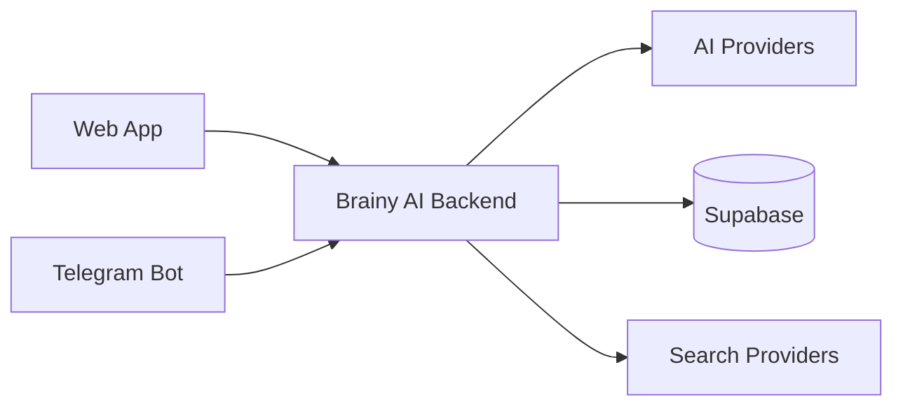

  

  <h1>BRAINY AI</h1>
  
<strong>Your AI-powered study companion.</strong>

  

    
    &nbsp;
    
    &nbsp;
    
  

  

    
    
    
    
    
    
  

---

## What is Brainy AI?

An AI-powered learning workspace for understanding concepts, exploring ideas, and keeping study activity organized — available on the web and through Telegram.

## Features

| | Feature | |
|:--:|:--|:--|
|  | **AI Study Chat** | Study-focused explanations and guided problem solving. |
|  | **Multi-Provider AI** | Configurable model routing and provider fallback. |
|  | **PDF Study Studio** | Work with learning documents and study resources. |
|  | **Telegram Bot** | Take study assistance and learning tools into Telegram. |
|  | **Search-Enabled Answers** | Connect answers to live search providers. |
|  | **Personal Workspace** | Keep conversations and study activity together. |

## Technology

  
  
  
  
  
  
  
  
  
  

| Layer | Stack |
|:--|:--|
| **Web** | Next.js · React · TypeScript · Tailwind CSS |
| **API** | Python · Flask |
| **Data & Auth** | Supabase · PostgreSQL |
| **AI & Search** | Configured AI providers · Tavily · DuckDuckGo |
| **Messaging** | Telegram Bot API |

## Security & privacy

Brainy AI includes application-level security controls in its backend:

- **Signed authentication:** HMAC-SHA256-signed bearer tokens with signature and expiry validation.
- **Session protection:** HTTP-only and Secure cookie settings, with configurable SameSite behavior.
- **Cross-origin checks:** Configured CORS origin allowlist and Origin/Referer validation for cookie-authenticated write requests.
- **Abuse controls:** IP-based request rate limiting, with shared Supabase-backed counters when configured.
- **Admin access control:** Admin privileges are checked server-side against configured user ID, username, and email allowlists.
- **Security headers:** Content Security Policy, HSTS in production, MIME-sniffing protection, referrer policy, and restricted browser permissions.
- **Safer API caching:** Sensitive API responses are marked private and non-cacheable.
- **Production login rules:** Unverified name-only login is disabled in production.

> **Security note:** These safeguards do not mean the application is breach-proof or independently certified. Production security also depends on deployment settings, secret management, dependency updates, and correctly configured Supabase table policies. Keep service-role keys and all provider credentials on the server — never in frontend code. No independent security audit is currently claimed.

## Architecture

## Project structure

| Path | Purpose |
|:--|:--|
| `app/` · `components/` | Web application and UI |
| `ai_routing/` | AI provider routing |
| `pdf_studio/` | PDF study features |
| `prompts/` | AI prompts |
| `study_bot.py` | Telegram bot |
| `app.py` · `security.py` | Backend API and security controls |

## Contributing

Ideas, bug reports, and pull requests are welcome. Open an issue to start a discussion.

## License

[MIT License](LICENSE)
