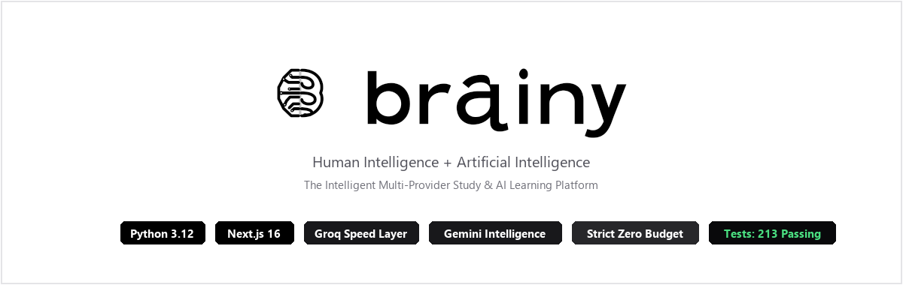
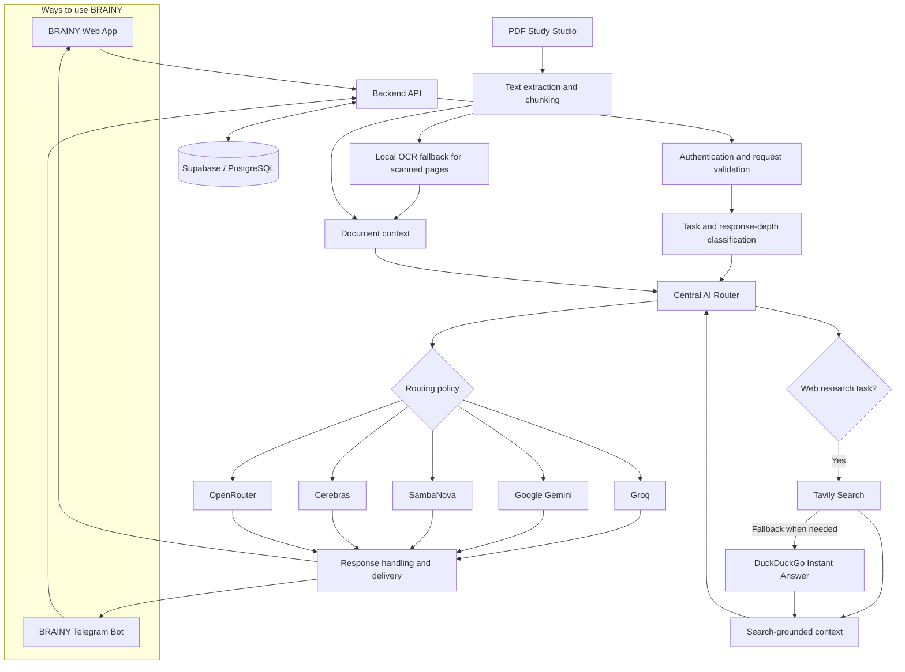

<div align="center">
  <a href="https://github.com/shreyanshio/BrainyAi">
    
  </a>

  <br /><br />

  <p align="center">
    
  </p>

  <p><strong>Human Intelligence + Artificial Intelligence</strong></p>
  <p><em>Your intelligent study companion, wherever you learn.</em></p>

  <p>
    <a href="https://brainyai.cenai.workers.dev/"><b>Open the Web App</b></a>
    &nbsp;·&nbsp;
    <a href="https://t.me/AiChatExpert_Bot"><b>Open the Telegram Bot</b></a>
    &nbsp;·&nbsp;
    <a href="./Brainy-Brand-Identity/08-Brand-Guidelines/brainy-brand-guidelines.pdf"><b>Brand Guidelines (PDF)</b></a>
    &nbsp;·&nbsp;
    <a href="https://github.com/shreyanshio/BrainyAi"><b>Explore the Source</b></a>
  </p>
</div>

---

## Meet BRAINY

BRAINY is an advanced, multi-provider AI assistant designed primarily as a study companion. It brings together a feature-rich **Telegram Bot** and a modern **web experience**, so you can learn in the way that feels most natural to you.

Use BRAINY to understand difficult concepts, ask follow-up questions, explore a topic from different angles, and turn learning material into something you can actively revise. Its routing layer can select between multiple AI providers based on the task and requested response depth, with fallback paths when a provider is unavailable.

BRAINY is being built around one simple idea: **AI should help you understand a subject, not just give you an answer.**

## What can you do with BRAINY?

| Experience | What it helps you do |
|:--|:--|
| **Study conversations** | Ask questions, request step-by-step explanations, and keep exploring with follow-up questions. |
| **Multi-provider AI** | Route requests across supported model providers instead of depending on a single AI service. |
| **PDF Study Studio** | Add study documents, extract and organize their content, and use the document workflow for notes, quizzes, and flashcards. |
| **Web research** | Ground research-oriented answers with search results and source links when search results are available. |
| **Telegram Bot** | Take BRAINY into Telegram for a familiar, chat-first experience. |
| **Personal workspace** | Keep conversations and study activity associated with your account through the configured data layer. |

### Try asking BRAINY

You can start with prompts like these:

- “Explain this topic like I am learning it for the first time, then give me a real-world example.”
- “Break this problem into small steps and explain why each step works.”
- “Turn my study material into concise revision notes and a short practice quiz.”
- “Compare these two concepts in a table and tell me when each one is useful.”

The best way to use BRAINY is to keep asking questions. Ask it to simplify an explanation, give another example, test your understanding, or approach the same idea from a different angle.

## AI providers and routing

BRAINY uses a provider-routing layer so that different tasks can use different models. The exact provider selected depends on the routing policy, configured API keys, and provider availability.

### Core providers in the central AI router

| Provider | How it is used in BRAINY |
|:--|:--|
| **Groq** | Fast and balanced chat generation, including quick-response routes. |
| **Google Gemini** | Explanations, deeper reasoning routes, and multimodal document/PDF requests. |
| **SambaNova** | An alternative inference route for fast and detailed responses. |
| **Cerebras** | An additional inference option in the routing and fallback chain. |
| **OpenRouter** | Access to selectable model routes, including the coding-oriented route configured in the registry. |

### Search integrations

| Service | Role |
|:--|:--|
| **Tavily** | Primary web-search integration for research grounding. |
| **DuckDuckGo Instant Answer** | Fallback when Tavily is unavailable or does not provide useful results. This is an Instant Answer endpoint, not a full web-search results API. |

### Additional adapters in the Telegram bot code

The repository also contains direct provider call implementations for **DeepSeek**, **NVIDIA NIM**, and **Mistral** in the bot's provider code. These are separate from the central `AIRouter` candidate chain shown above, so their availability depends on the bot path and the corresponding configuration.

Provider availability is configuration-dependent. Listing a provider here does not mean an API key is included, that every provider is enabled in every deployment, or that every provider is used for every request. Never commit API keys or secrets.

## How BRAINY works

The two entry points connect to the backend, where requests are validated and routed. The router classifies the task and response depth, chooses from the configured provider chain, and can move to another candidate when a provider fails. Research requests can use the search-grounding path. User and study data are persisted through the configured Supabase layer.



## Technology

| Layer | Technologies |
|:--|:--|
| **Web application** | Next.js, React, TypeScript, Tailwind CSS |
| **Backend API** | Python, Flask |
| **AI orchestration** | Custom task classification, provider registry, routing policy, key rotation, and fallback handling |
| **Database and authentication** | Supabase, PostgreSQL |
| **Document processing** | Local PDF text extraction, chunking, and optional Tesseract OCR fallback |
| **Search** | Tavily, DuckDuckGo Instant Answer |
| **Messaging** | Telegram Bot API |
| **Web delivery** | Cloudflare |

## Project structure

| Path | Purpose |
|:--|:--|
| `app/` | Next.js routes and pages |
| `components/` | Reusable web interface components |
| `ai_routing/` | Task classification, provider registry, routing policy, and AI orchestration |
| `ai_routing/providers/` | Provider adapters used by the central router |
| `pdf_studio/` | PDF extraction, chunking, OCR, and study workflows |
| `prompts/` | Reusable assistant prompt resources |
| `study_bot.py` | Telegram bot and its direct provider integrations |
| `app.py` | Flask backend API |
| `security.py` | Authentication and application security controls |
| `screenshots/` | Screenshots of the BRAINY web experience |

## Screenshots

<!-- Intentionally left empty until the web screenshots are uploaded to the screenshots/ folder. -->

## Security and privacy

The backend includes application-level security controls such as:

- HMAC-SHA256-signed bearer tokens with signature and expiry validation.
- HTTP-only and Secure session-cookie settings, with configurable SameSite behavior.
- CORS origin allowlisting and Origin/Referer validation for cookie-authenticated write requests.
- IP-based request rate limiting, with shared Supabase-backed counters when configured.
- Server-side admin checks against configured user ID, username, and email allowlists.
- Security headers, including Content Security Policy and production HSTS.
- Private, non-cacheable handling for sensitive API responses.

> **Security note:** These controls do not make an application breach-proof and are not a claim of independent security certification. Production security also depends on deployment configuration, secret management, dependency updates, and correctly configured Supabase policies. Keep service-role keys and provider credentials on the server, never in frontend code. No independent security audit is claimed here.

## Run it locally

1. Clone the repository:
   ```bash
   git clone https://github.com/shreyanshio/BrainyAi.git
   cd BrainyAi
   ```
2. Install the project dependencies:
   ```bash
   npm install
   pip install -r requirements.txt
   ```
3. Copy `.env.example` to `.env` and add the credentials for the services you intend to configure. Do not add real secrets to Git.
4. Start the frontend and backend using the scripts and deployment configuration for your environment.

Some features require their corresponding provider keys, Supabase configuration, or Telegram bot token. You can run only the parts you have configured.

## Get involved

BRAINY is an evolving project, and thoughtful feedback makes it better. Try the web app or Telegram bot, share what helped you learn, report bugs, suggest features, or contribute improvements.

- **Try it:** [BRAINY Web App](https://brainyai.cenai.workers.dev/)
- **Chat with it:** [BRAINY on Telegram](https://t.me/AiChatExpert_Bot)
- **Contribute:** [Open an issue or pull request](https://github.com/shreyanshio/BrainyAi)

If BRAINY helps you study, consider giving the repository a star and sharing it with someone who enjoys learning with technology.

---

<div align="center">
  <strong>Keep asking. Keep learning. Stay BRAINY.</strong>
</div>
