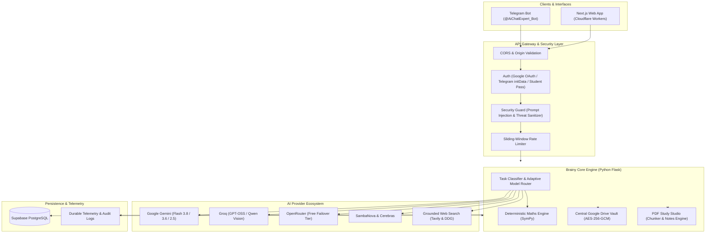

<div align="center">
  <a href="https://brainyai.cenai.workers.dev/">
    
  </a>

  <h2>Think Deeper. Learn Faster. Study Smarter.</h2>
  <p>An enterprise-grade, multi-model AI study companion and academic intelligence engine — built for deep problem solving, multimodal vision reasoning, interactive document studio, and real-time cross-platform synchronization.</p>

  <p>
    <a href="https://brainyai.cenai.workers.dev/"></a>
    <a href="https://t.me/AiChatExpert_Bot"></a>
    <a href="https://github.com/shreyanshio/BrainyAi"></a>
    <a href="https://github.com/shreyanshio/BrainyAi/issues/new"></a>
  </p>

  <p>
    
    
    
    
    
    
    
  </p>
</div>

---

## ⚡ Overview

**Brainy AI** is a production-grade educational intelligence platform engineered to bridge interactive natural language understanding, mathematical precision, multimodal vision reasoning, and document analysis. 

Instead of locking students to a single closed-source model, Brainy features an **adaptive, 4-tier AI routing engine** that dynamically routes each query based on task complexity, token economics, latency requirements, and provider availability across Google Gemini, Groq, OpenRouter, SambaNova, and Cerebras.

Whether accessed via the responsive **Next.js Web Application** or the high-performance **Telegram Bot**, user conversations, study notes, document vaults, and quota metrics remain completely synchronized in real time.

---

## 🌟 Core Capabilities

### 🧠 Adaptive Multi-Tier AI Routing
- **Tier 1 (Advanced Reasoning & Multimodal):** Google Gemini (`gemini-3.8-flash`, `gemini-3.6-flash`, `gemini-2.5-flash`) for nuanced conceptual explanations, complex problem breakdowns, and image comprehension.
- **Tier 2 (Ultra-Low Latency):** Groq OSS (`gpt-oss-20b`, `gpt-oss-120b`, `qwen/qwen3.8-27b`) delivering lightning-fast conversational streaming (<300ms time-to-first-token).
- **Tier 3 (Zero-Budget & Free Failover):** OpenRouter Free tier (`nemotron-3.5-super-vl:free`, `openrouter/free`, `gemma-4-31b-it:free`) ensuring high availability even under upstream provider outages.
- **Tier 4 (Hardware-Accelerated Reasoning):** SambaNova Systems & Cerebras for high-throughput arithmetic and symbolic computation.
- **Autonomous Health Circuit Breaker:** Real-time provider error tracking, automatic failover, and quarantine windows preventing service disruption.

### 📷 End-to-End Multimodal Vision
- Upload, drag-and-drop, or paste textbook problems, handwritten equations, diagrams, and scientific figures.
- Dual-provider vision pipeline normalizes base64 image data into Google Gemini REST `inlineData` and Groq OpenAI-compatible `image_url` payloads.
- Automated media exemption in security filters eliminates false-positive blocks while inspecting query prompts for threats.

### 📄 PDF Study Studio & Active Recall
- **Text & Structure Extraction:** Ingests textbooks, lecture notes, and research papers using PyMuPDF (`fitz`) with semantic chunking and layout preservation.
- **OCR Fallback:** Automated Tesseract OCR extraction for scanned non-digital documents.
- **Hierarchical Study Notes:** Generates structured Markdown notes with key definitions, formulas, and actionable summaries.
- **Interactive Quizzes & Flashcards:** Automatic extraction of spaced-repetition flashcards and graded multiple-choice practice quizzes.
- **Document Q&A:** Grounded context retrieval with chunk attribution and inline citations.

### ☁️ Centralized Google Drive Vault
- Single-owner architecture with authenticated AES-256-GCM encryption for cloud storage.
- User files, chat attachments, and study artifacts are organized into structured directories within a dedicated storage hierarchy.
- Seamless fallback to encrypted local vaults when cloud synchronization is paused.

### 🎛️ Real-Time Admin Analytics & Observability
- 100% database-backed metrics dashboard: Tracks actual Registered Users, DAU, WAU, MAU, request volume, token spend, and response latencies without mocked data.
- Live rate-limit monitoring and instant administrative unblock controls.
- Dynamic runtime model toggling, provider health probes, and live audit trails.

### 📱 Telegram Bot Experience (`@AiChatExpert_Bot`)
- Multimodal query handling supporting voice notes, document uploads, and images.
- Flood-control resilience with adaptive backoff (`RetryAfter`) and non-blocking background workers.
- Native interactive quiz polls, study flashcards, and personalized 7-day study plans on the fly.

---

## 🏛️ System Architecture



---

## 💻 Tech Stack

| Layer | Technologies |
|:--|:--|
| **Frontend** | [Next.js 16.3](https://nextjs.org/) (App Router, Static Export), [React 19](https://react.dev/), [TypeScript 5.7](https://www.typescriptlang.org/), [Tailwind CSS 3.4](https://tailwindcss.com/), [KaTeX](https://katex.org/) (Math rendering), Lucide Icons |
| **Backend & WSGI** | [Python 3.12](https://www.python.org/), [Flask 3.0](https://flask.palletsprojects.com/), [Gunicorn](https://gunicorn.org/), [Asyncio](https://docs.python.org/3/library/asyncio.html) |
| **Persistence & Auth** | [Supabase](https://supabase.com/) (PostgreSQL 15, PostgREST), Row Level Security (RLS), Google OAuth 2.0, Telegram WebApp `initData` HMAC-SHA256 |
| **AI Routing & Inference** | Google Generative AI SDK, Groq SDK, OpenRouter API, Cerebras SDK, SambaNova Systems, Tavily Search API |
| **Document Processing** | PyMuPDF (`fitz`), PyTesseract OCR, SymPy, Google Drive REST API v3 |
| **Messaging & Bot** | [python-telegram-bot](https://python-telegram-bot.org/) v21 (Async Application Loop) |
| **Hosting & CDN** | Cloudflare Workers & Pages (Frontend), Render.com Web Services (Backend) |

---

## 🚀 Quick Start & Local Development

### Prerequisites
- Node.js 20+ and npm 10+
- Python 3.11 or 3.12
- Git

### 1. Clone the Repository
```bash
git clone https://github.com/shreyanshio/BrainyAi.git
cd BrainyAi
```

### 2. Set Up the Python Backend
```bash
# Create and activate virtual environment
python -m venv .venv

# Windows PowerShell:
.venv\Scripts\Activate.ps1

# macOS / Linux:
source .venv/bin/activate

# Install dependencies
pip install -r requirements.txt
```

### 3. Configure Environment Variables
Copy `.env.example` to `.env` and fill in your credentials:
```bash
cp .env.example .env
```

Key environment configurations:
```ini
# Flask Secret & Security
SECRET_KEY=your_secure_flask_secret_key
ENCRYPTION_KEY=your_32_byte_aes_gcm_hex_key

# Supabase Database
SUPABASE_URL=https://your-project.supabase.co
SUPABASE_KEY=your_supabase_anon_or_service_key

# AI Provider Keys (Configure at least one)
GEMINI_API_KEY=your_google_gemini_api_key
GROQ_API_KEYS=your_groq_api_key
OPENROUTER_API_KEY=your_openrouter_api_key

# Telegram Bot (Optional for web-only dev)
TELEGRAM_BOT_TOKEN=your_telegram_bot_token

# Frontend / CORS
FRONTEND_URL=http://localhost:3000
```

### 4. Start the Backend Server
```bash
python app.py
```
*The Flask backend will start on `http://localhost:5000` with all 94 API endpoints registered.*

### 5. Set Up the Next.js Frontend
In a separate terminal:
```bash
npm install
npm run dev
```
*Open [http://localhost:3000](http://localhost:3000) in your browser.*

---

## 📁 Repository Structure

```text
BrainyAi/
├── ai_routing/               # AI Router, Multi-Tier Policies, Provider Adapters & Telemetry
│   ├── intent/               # Intent Classification Catalogs & Rules
│   ├── providers/            # Gemini, Groq, OpenRouter, SambaNova, Cerebras Adapters
│   ├── policy.py             # Tier Routing Policies & Circuit-Breaker Quarantine
│   ├── registry.py           # Model Capabilities & Cost Registry
│   └── router.py             # Central Task Classifier & Failover Dispatcher
├── app/                      # Next.js 16 App Router (Core Chat, Admin Dashboard, 404)
│   ├── admin/                # Production Real-Time Admin Analytics Dashboard
│   └── page.tsx              # Conversational Workspace & Multimodal Attachment Deck
├── components/               # Production React 19 UI Component Suite
│   ├── app-shell/            # Header, Sidebar, Navigation
│   ├── chat/                 # Message Stream, Composer, Attachment Dropzone
│   ├── markdown/             # KaTeX Math & Syntax-Highlighted Code Renderer
│   └── pdf/                  # PDF Study Studio Interface
├── migrations/               # Supabase PostgreSQL SQL Migrations (001 - 004)
├── pdf_studio/               # Document Extraction, Chunking, OCR & Notes Engines
├── prompts/                  # System Prompts, Subject Directives & Registry Configurations
├── public/                   # Static Frontend Assets, Logos & Icons
├── app.py                    # Core Flask Backend Server (94 API Endpoints)
├── file_service.py           # File Validation, MIME Inspection & Local Storage Helpers
├── security.py               # Authentication Middleware, Rate Limiting & Threat Sanitizer
├── start_render.sh           # Production Dual-Runner (Gunicorn Web + Background Telegram Bot)
├── study_bot.py              # Telegram Bot Worker with Resilient Flood-Control Pipeline
├── next.config.mjs           # Next.js Static Export Configuration
└── requirements.txt          # Python Production Dependencies
```

---

## 🔒 Security & Privacy Practices

- **Strict User Isolation:** Private chats, uploaded files, and liked notes are bound strictly to the verified owner ID. Group chats operate with zero memory pollution.
- **HMAC & AES-256-GCM:** All session tokens and Google Drive refresh tokens are encrypted at rest using industry-standard authenticated cryptography.
- **Sanitized Media Inspection:** Base64 media payloads are inspected for valid MIME signatures and strictly exempted from regex false positives without disabling threat guards on user text.
- **Zero Secret Exposure:** No API keys, credentials, or private user data are committed to version control. All secrets are injected dynamically via environment variables.

---

## 🤝 Contributing

Contributions, feature requests, and bug reports are welcome!

1. Fork the Project repository.
2. Create your Feature Branch (`git checkout -b feature/AmazingFeature`).
3. Commit your Changes (`git commit -m 'feat: add amazing feature'`).
4. Push to the Branch (`git push origin feature/AmazingFeature`).
5. Open a Pull Request.

---

## 📄 License

Distributed under the MIT License. See [`LICENSE`](file:///C:/Users/Shrey/.gemini/antigravity/worktrees/BrainyAi/implement_image_intelligence_drive/LICENSE) for more information.

<div align="center">
  <br />
  <p>Crafted with precision for students, educators, and curious minds worldwide.</p>
  <b>Think Deeper. Learn Faster. Stay Brainy.</b>
</div>
