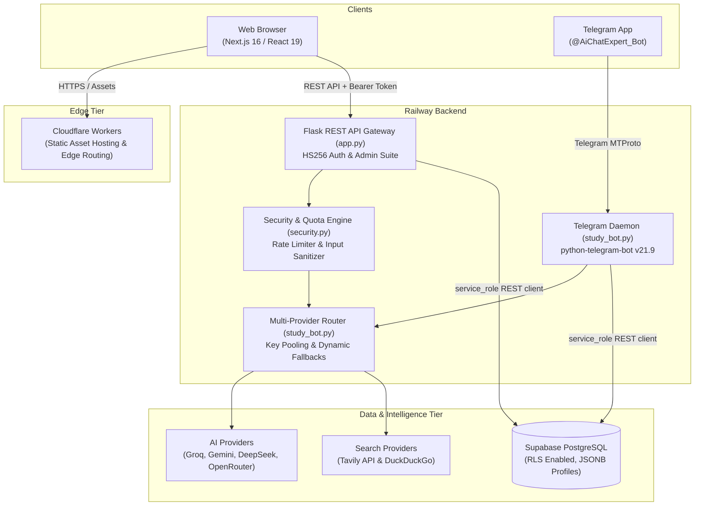

# 🧠 Brainy AI — AI Study Companion & Academic SaaS Platform

<div align="center">
  <p>
    <a href="https://github.com/shreyanshio/BrainyAi"></a>
    <a href="https://brainyai.cenai.workers.dev"></a>
    <a href="https://t.me/AiChatExpert_Bot"></a>
    <a href="https://t.me/aurabreaker7"></a>
    <a href="LICENSE"></a>
  </p>

  <p><strong>A production-ready, multi-provider AI study companion and academic SaaS platform built with Next.js 16, Cloudflare Workers, Python Flask, and Supabase.</strong></p>
</div>

---

## 1. Project Introduction

**Brainy AI** is an open-source academic intelligence platform and study companion designed for students, researchers, and self-directed learners. It bridges a high-performance, distraction-free **Next.js web workspace** deployed on **Cloudflare Workers** with an omni-channel **Telegram study bot** ([`@AiChatExpert_Bot`](https://t.me/AiChatExpert_Bot)), keeping study streaks, bookmarks, and conversation history synchronized across devices.

### The Problem It Solves
Most commercial conversational AI models provide generic, superficial answers that often skip foundational reasoning, fail to format complex mathematical proofs cleanly, or encourage students to copy answers without understanding the underlying principles. Furthermore, students frequently work across different devices (desktop at a desk, mobile during a commute) with fragmented study notes and scattered chat sessions.

### Our Approach
Brainy AI addresses these challenges with a specialized academic architecture:
* **Socratic Pedagogical Guidance**: Breaks down complex physics, chemistry, and mathematics numericals step-by-step rather than giving immediate unearned answers.
* **Multi-Provider AI Routing**: Automatically dispatches queries across 10+ AI backends (Groq, Google Gemini, DeepSeek, Cerebras, OpenRouter, etc.) based on the subject category and real-time provider health.
* **Continuous Omni-Channel Sync**: Chat sessions, flashcards, and personalized notes remain synchronized between the Telegram bot and the web application.
* **Distraction-Free Environment**: Calibrated with 5 high-contrast, distraction-free themes (zero purple or lavender tones) and 9 academic typography options.

---

## 2. Key Features

### 🎓 Academic AI & Reasoning
* **Dynamic Multi-Provider AI**: Routes requests to optimal models (Groq Llama 3.3 70B, Google Gemini, DeepSeek R1) with automatic failover and key pooling.
* **Socratic Problem Solving**: Step-by-step pedagogical breakdowns for STEM numericals and theoretical proofs.
* **Deep Learning Mode (`/brainy`)**: In-depth theoretical syntheses and conceptual foundations.
* **5-Perspective Explanations (`/ask5`)**: Explains challenging concepts across 5 distinct pedagogical angles.
* **Live Search Grounding**: Real-time factual queries and literature citations powered by the Tavily API and DuckDuckGo.
* **Mathematical Notation**: Real-time LaTeX parsing and block equation rendering powered by KaTeX.

### 💻 Web Application Workspace
* **Direct Chat Workspace**: Authenticated students land immediately in an active study workspace with zero unnecessary clicks.
* **Aptivus Student Dashboard**: Includes an interactive 25-minute Pomodoro study sprint timer, quick-action prompt cards, and notebook bookmarks.
* **Dedicated Admin Control Panel (`/admin`)**: Real-time Supabase telemetry (active users, session count, message volume), student search, account suspension, and system health checks.
* **5 Calibrated Themes**: Warm Paper, Pure Light, Midnight Slate, Graphite Dark, and OLED Pitch Black.
* **9 Academic Typography Styles**: Live selectable fonts including Inter, Geist, Plus Jakarta Sans, DM Sans, Manrope, IBM Plex Sans, Lora, Source Serif, and JetBrains Mono.
* **Session Tools**: Full-text in-session search, text export (`.txt`), and clipboard copying.

### 📱 Telegram Bot Daemon
* **Interactive Quizzes & Drills**: Subject-wise multiple-choice questions with per-chat leaderboards (`/quiz`, `/leaderboard`).
* **Chapter Flashcards**: Flashcards categorized by syllabus topic (`/flashcards`).
* **Formula Quick-Reference**: Instant reference cheat sheets for mathematics and physical sciences (`/formula`).
* **Adaptive Study Plan**: Personalized 7-day revision schedules (`/myplan`).
* **Reaction Bookmarks**: Reacting with 👍 to an AI response automatically saves it to your personal study notebook (`/mynotes`).
* **1-Click Web Handshake**: Sending `/login` generates pre-authenticated, magic-link access to the web sanctuary.

### 🔐 Security & Defensive Architecture
* **Dual-Token Authentication**: Signed HS256 Bearer tokens passed via HTTP headers to prevent cross-origin cookie restrictions between Cloudflare and Railway.
* **Server-Authoritative 5-Hour Quotas**: Atomic quota limiting users to 30 queries per 5-hour window, enforced strictly on the server.
* **Prompt Privacy Obfuscation**: User study questions and conversation titles are masked using SHA-256 before storage in Supabase.
* **Input Sanitization & Abuse Guards**: Automated regex blacklist intercepting prompt injection, jailbreak attempts, and malicious control characters.
* **Supabase Row Level Security (RLS)**: Enforced across all tables, denying anonymous access and mediating operations exclusively via privileged backend service credentials.

---

## 3. Technology Stack

| Layer | Technologies | Purpose |
|---|---|---|
| **Frontend** | Next.js 16.3.3, React 19, TypeScript, Tailwind CSS v4, Lucide Icons | Responsive web application interface |
| **Math & Markdown** | KaTeX, react-markdown, rehype-katex, remark-gfm, remark-math | Mathematical formula & markdown rendering |
| **Edge Hosting** | Cloudflare Workers (Static Asset Routing via Wrangler) | Global edge distribution with zero cold-starts |
| **Backend API Gateway** | Python 3.10+, Flask 3.0+, Gunicorn | REST API, session lifecycle & auth handshake |
| **Telegram Daemon** | `python-telegram-bot` v21.9 | Asynchronous event worker for Telegram bot |
| **Database** | Supabase PostgreSQL with Row Level Security (RLS) | Relational storage, user memory & session history |
| **AI Providers** | Groq, Gemini, DeepSeek, Cerebras, OpenRouter, SambaNova, Together, Mistral, OpenAI, Nvidia | Multi-provider intelligence & reasoning |
| **Search Engine** | Tavily API + DuckDuckGo | Real-time web retrieval & citation grounding |
| **Container Hosting** | Railway | Cloud container execution for Flask API & Bot worker |

---

## 4. Architecture & System Flow



---

## 5. Prerequisites

Before installing Brainy AI locally, ensure you have the following installed and configured:

* **Node.js**: v18.17 or later (Node 20+ recommended)
* **Python**: v3.10 or later
* **Git**
* **Package Managers**: `npm` (bundled with Node.js) and `pip`
* **Supabase Project**: A free project on [Supabase](https://supabase.com)
* **AI Provider Credentials**: An API key from at least one supported provider (e.g., [Groq](https://console.groq.com) or [Google AI Studio](https://aistudio.google.com))
* **Telegram Bot Token** *(Optional)*: If running the Telegram daemon, a bot token from [@BotFather](https://t.me/BotFather)

---

## 6. Installation & Local Development

### Step 1: Clone the Repository
```bash
git clone https://github.com/shreyanshio/BrainyAi.git
cd BrainyAi
```

### Step 2: Configure Environment Variables
Copy the template and fill in your credentials:
```bash
cp .env.example .env
```
Open `.env` in your editor and configure your secrets:
* `FLASK_SECRET_KEY`: Generate a random hex string: `python -c "import secrets; print(secrets.token_hex(32))"`
* `SUPABASE_URL` and `SUPABASE_SERVICE_KEY`: Copy the Project URL from the Connect dialog and the Secret API key from **Settings > API Keys**. The legacy `SUPABASE_KEY` name is still accepted.
* `GROQ_API_KEY` or `GEMINI_API_KEY`: Provide your AI API credentials

### Step 3: Setup the Backend (Python Flask API)
```bash
# Create and activate a virtual environment
python -m venv venv

# On Windows:
.\venv\Scripts\activate

# On macOS / Linux:
source venv/bin/activate

# Install dependencies
pip install -r requirements.txt
```

### Step 4: Setup the Frontend (Next.js)
```bash
npm install
```

### Step 5: Initialize the Database Schema
1. Open the [Supabase Dashboard](https://supabase.com/dashboard) and navigate to the **SQL Editor**.
2. Copy and paste the contents of [`supabase_schema.sql`](supabase_schema.sql).
3. Click **Run**. The script will safely create all 8 tables, indexes, and Row Level Security policies.

### Step 6: Start the Development Servers
Open two terminal windows:

* **Terminal 1 — Backend API Gateway**:
  ```bash
  python app.py
  ```
  The Flask server starts at `http://localhost:5000`.

* **Terminal 2 — Frontend Application**:
  ```bash
  npm run dev
  ```
  The Next.js client starts at `http://localhost:3000`.

* **Terminal 3 (Optional) — Telegram Bot Daemon**:
  ```bash
  python study_bot.py
  ```

### Step 7: Verify Installation
* Open your browser and navigate to `http://localhost:3000`.
* Enter your name via the **1-Click Student Pass** or **Web Login**.
* You will be immediately redirected to the chat workspace. Send a query (e.g., `"Explain Newton's third law with an example"`) to confirm AI routing.
* Test the backend health probe:
  ```bash
  curl http://localhost:5000/api/health
  # Returns: {"status": "ok", "service": "brainy-api"}
  ```

---

## 7. Environment Variables Reference

| Variable | Required | Service | Description |
|---|---|---|---|
| `PORT` | Optional | Flask | HTTP port for the backend (default: `5000`) |
| `FLASK_SECRET_KEY` | **Required** | Flask | Secret for signing HS256 Bearer tokens and session cookies |
| `FRONTEND_URL` | Optional | Flask | Public URL of frontend (default: `https://brainyai.cenai.workers.dev`) |
| `ALLOWED_ORIGINS` | **Required** | Flask | Comma-separated allowed CORS origins |
| `NEXT_PUBLIC_API_URL` | Optional | Next.js | Base backend URL (leave empty for same-origin dev) |
| `SUPABASE_URL` | **Required** | Flask / Bot | Supabase project REST URL |
| `SUPABASE_SERVICE_KEY` | **Required** | Flask / Bot | Supabase Secret API key (or legacy service-role JWT), kept private on server |
| `ADMIN_USER_IDS` | Optional | Flask | Comma-separated Telegram user IDs allowed in `/admin` |
| `ADMIN_USERNAMES` | Optional | Flask | Comma-separated usernames allowed in `/admin` |
| `ADMIN_EMAILS` | Optional | Flask | Comma-separated admin emails allowed in `/admin` |
| `GOOGLE_CLIENT_ID` | Optional | Flask | Google OAuth 2.0 Client ID for Web Sign-In |
| `TELEGRAM_TOKEN` | Optional | Bot | Telegram bot API token from @BotFather |
| `OWNER_ID` | Optional | Bot | Telegram user ID of the bot maintainer |
| `GROQ_API_KEY` | Recommended | Both | Groq API key (supports `GROQ_API_KEY_1..8`) |
| `GEMINI_API_KEY` | Recommended | Both | Google Gemini API key (supports `GEMINI_API_KEY_1..8`) |
| `OPENROUTER_API_KEY`| Optional | Both | OpenRouter API key for DeepSeek fallback |
| `TAVILY_API_KEY` | Optional | Both | Tavily API key for real-time live search grounding |
| `GLOBAL_MESSAGE_LIMIT`| Optional | Flask | Number of queries per quota window (default: `30`) |
| `QUOTA_WINDOW_HOURS`| Optional | Flask | Quota reset cycle in hours (default: `5`) |

## 8. Database Architecture

Brainy AI stores state across 8 PostgreSQL tables managed with Row Level Security:

1. `bot_users`: Registered Telegram students and interaction timestamps.
2. `user_memory`: Learning progress, score records, and saved note bookmarks.
3. `user_logins`: Real authentication telemetry and login audit logs.
4. `chat_sessions`: Grouped conversation session threads.
5. `chat_messages`: Individual interaction exchanges with role classification.
6. `user_preferences`: Student interface settings (theme, typography).
7. `quiz_polls`: Interactive Telegram MCQs and answer keys.
8. `quiz_scores`: Cumulative quiz scores and leaderboards.

For the complete schema specifications and SQL scripts, see [`supabase_schema.sql`](supabase_schema.sql).

---

## 9. Production Deployment

Brainy AI is architected for deployment across **Cloudflare Workers** and **Railway**:

* **Frontend (Cloudflare Workers)**:
  ```bash
  npm run build
  npm run deploy
  ```
  Exports static assets to `out/` and routes them globally via Cloudflare's edge network.
* **Backend & Worker (Railway)**:
  Railway automatically detects the repository's [`Procfile`](Procfile) and starts:
  - `web: gunicorn app:app --bind 0.0.0.0:$PORT --workers 2 --timeout 120`
  - `worker: python study_bot.py`

---

## 10. Troubleshooting

| Issue | Likely Cause | Solution |
|---|---|---|
| **Auth fails / cross-origin requests blocked** | Browser third-party cookie restrictions | Ensure you are on v2.0+ which uses `Authorization: Bearer <token>` in `lib/api.ts`. Verify `ALLOWED_ORIGINS` contains your frontend domain in backend env. |
| **`429 Too Many Requests` (Quota Exceeded)** | 5-hour quota exhausted | Wait for the 5-hour window to reset (default: 30 messages / 5 hours). Administrators can adjust `GLOBAL_MESSAGE_LIMIT` in `.env`. |
| **`403 Forbidden` on `/admin`** | User not in admin allowlist | Add your user ID, username, or email to `ADMIN_USER_IDS`, `ADMIN_USERNAMES`, or `ADMIN_EMAILS` on the server and restart. |
| **AI responses fail / timeouts** | Missing or rate-limited API keys | Verify that at least one AI key (`GROQ_API_KEY` or `GEMINI_API_KEY`) is populated in `.env`. Check backend logs for provider error status. |
| **Supabase permission errors** | Public key used instead of a backend key | Ensure `SUPABASE_SERVICE_KEY` in Railway is the private Secret API key (or legacy `service_role` key), never the publishable/anon key. |

---

## 11. Testing & Code Quality

Validate the repository before committing changes:

```bash
# 1. Compile Python source files for syntax and import consistency
python -m py_compile app.py security.py study_bot.py

# 2. Run mocked backend contract tests
python -m unittest discover -s tests -v

# 3. Run TypeScript compiler and Next.js production export build
npm run build
```

---

## 12. License & Disclaimer

Brainy AI is distributed under the terms of the **MIT License**. See [`LICENSE`](LICENSE) for details.

### Academic & Learning Disclaimer
This software is developed and shared for educational purposes, personal study enhancement, and AI architecture research. It is open-sourced under the MIT License to encourage collaborative learning. Users self-hosting Brainy AI are responsible for maintaining their own API keys, database credentials, and compliance with external provider terms of service.
