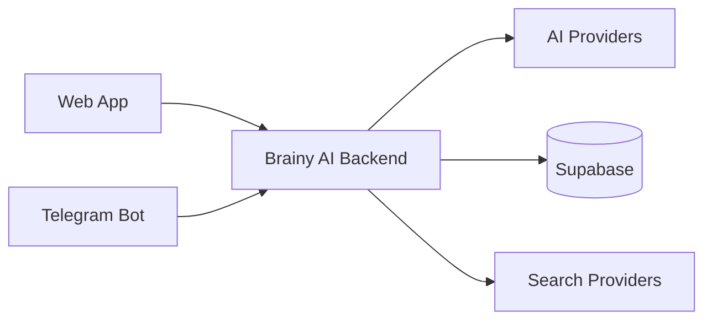

  

  <h1>BRAINY AI</h1>
  
<strong>Your AI-powered study companion.</strong>

  

    <a href="https://brainyai.cenai.workers.dev/"><strong>🌐 Open Web App</strong></a>
    &nbsp; · &nbsp;
    <a href="https://t.me/AiChatExpert_Bot"><strong>✈️ Open Telegram Bot</strong></a>
  

  

    
    
    
    
  

---

## What is Brainy AI?

Brainy AI is an AI-powered learning workspace that helps students understand concepts, explore ideas, and keep their study workflow in one place — on the web and through Telegram.

## What you can do

| Feature | What it offers |
|:--|:--|
| **AI Study Chat** | Ask questions and get clear, study-focused explanations. |
| **Multi-Provider AI** | Uses the configured AI providers with routing and fallback support. |
| **PDF Study Studio** | Work with study documents and turn learning material into study resources. |
| **Telegram Study Bot** | Access study assistance and learning tools directly in Telegram. |
| **Search-Enabled Answers** | Retrieve relevant information from connected search providers. |
| **Personal Workspace** | Keep conversations and study activity organized. |

## Built with

| Part | Technologies |
|:--|:--|
| **Frontend** | Next.js · React · TypeScript · Tailwind CSS |
| **Backend** | Python · Flask |
| **Database & Auth** | Supabase · PostgreSQL |
| **AI & Search** | Configurable AI providers · Tavily · DuckDuckGo |
| **Telegram** | Python Telegram Bot |

## How it fits together

## Project structure

| Directory / file | Purpose |
|:--|:--|
| `app/` · `components/` | Web application and UI components |
| `ai_routing/` | AI provider routing |
| `pdf_studio/` | PDF study features |
| `prompts/` | AI prompts |
| `study_bot.py` | Telegram bot |
| `app.py` | Python backend API |

## Explore Brainy AI

  <a href="https://brainyai.cenai.workers.dev/"><strong>Launch Brainy AI ↗</strong></a>
  &nbsp; · &nbsp;
  <a href="https://t.me/AiChatExpert_Bot"><strong>Chat on Telegram ↗</strong></a>
  &nbsp; · &nbsp;
  <a href="https://github.com/shreyanshio/BrainyAi"><strong>View on GitHub ↗</strong></a>

## Contributing

Suggestions, bug reports, and pull requests are welcome. Open an issue to discuss an idea or report a problem.

## License

Released under the [MIT License](LICENSE).
