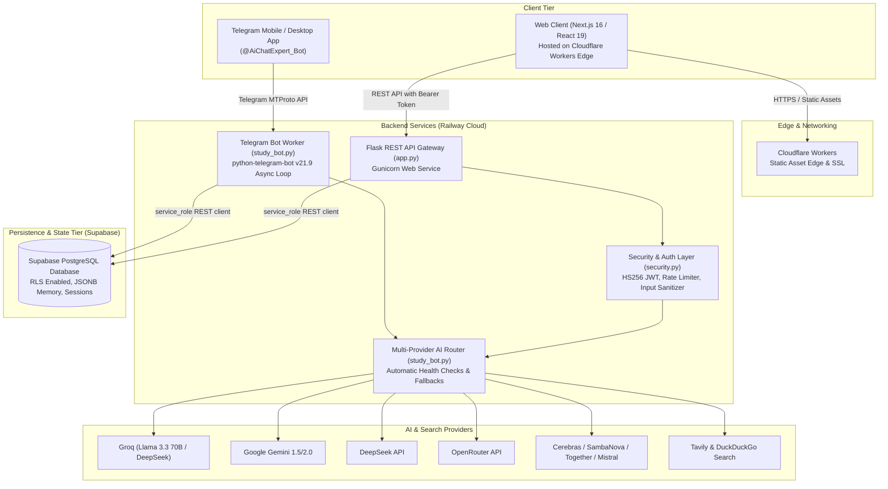
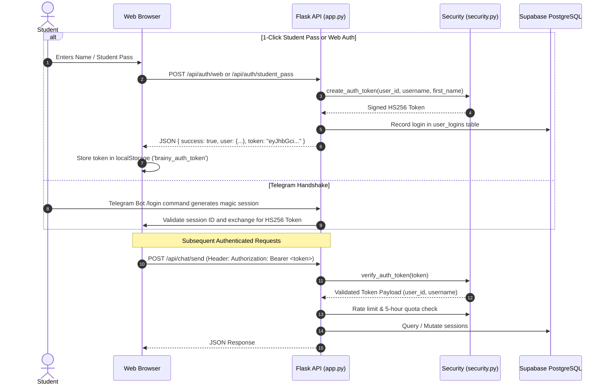

# Architecture & System Design — Brainy AI

This document provides a comprehensive technical overview of the architecture, data flow, trust boundaries, and security model of **Brainy AI**.

---

## 1. High-Level System Topology

Brainy AI is built on a decoupled, distributed architecture optimized for low-latency web interactions, omni-channel Telegram study assistance, and multi-provider AI resilience.



---

## 2. Core Components & Responsibilities

### A. Web Client (Next.js App Router)
- **Framework**: Next.js 16.3.3, React 19, TypeScript, Tailwind CSS v4.
- **Rendering**: Static Export (`output: 'export'`), pre-rendered into `out/` and deployed directly to **Cloudflare Workers**.
- **Capabilities**:
  - Direct default entry into the study chat workspace.
  - Aptivus student dashboard with interactive 25-minute Pomodoro study sprints.
  - Real-time LaTeX / mathematical equation rendering via KaTeX.
  - Multi-theme engine (5 calibrated distraction-free themes without purple shades).
  - Client-side token storage in `localStorage` with automatic `Authorization: Bearer <token>` attachment on API calls.

### B. Flask REST API Gateway (`app.py`)
- **Runtime**: Python 3.10+, Flask 3.0+, Gunicorn.
- **Responsibilities**:
  - Serves REST endpoints for authentication, session lifecycle, message sending, and profile statistics.
  - Enforces cross-origin request policies (CORS) with configurable `ALLOWED_ORIGINS`.
  - Bridges browser chat requests to the multi-provider routing engine (`study_bot.ai_call`).
  - Hosts the protected `/api/admin/*` administrative control suite.

### C. Telegram Bot Daemon (`study_bot.py`)
- **Runtime**: Python 3.10+, `python-telegram-bot` v21.9.
- **Responsibilities**:
  - Runs as an independent worker process handling command interactions (`/start`, `/quiz`, `/flashcards`, `/myplan`, `/mynotes`).
  - Facilitates 1-click web login handshakes (`/login`) generating pre-authenticated access tokens.
  - Provides multi-modal vision query resolution (`/image`) for textbook diagrams and equations.

### D. Multi-Provider AI Router (`study_bot.py`)
- Dynamically selects model endpoints based on the pedagogical category of the query:
  - **Socratic STEM Numericals & Deep Theoretical Reasoning**: Groq Llama 3.3 70B, Google Gemini, DeepSeek R1.
  - **Rapid Banter, Motivation & Flashcards**: Cerebras, SambaNova, Groq 8B.
  - **Live Grounding & Current Events**: Tavily API real-time search extraction with DuckDuckGo fallback.
- Features automatic multi-key round-robin pooling (`GROQ_API_KEY_1..5`, `GEMINI_API_KEY_1..5`) and graceful failover on rate-limiting (HTTP 429) or model downtime.

### E. Database Layer (Supabase PostgreSQL)
- Houses 8 relational tables:
  1. `bot_users`: Registered Telegram users and last active timestamps.
  2. `user_memory`: Student learning profiles, score history, and liked notebook annotations.
  3. `user_logins`: Audit telemetry of web and bot authentication events.
  4. `chat_sessions`: Grouped conversation threads.
  5. `chat_messages`: Individual interaction exchanges with role classification (`user`, `assistant`).
  6. `user_preferences`: Stored client preferences (theme, typography).
  7. `quiz_polls`: Interactive MCQ questions and answer keys.
  8. `quiz_scores`: Aggregate quiz performance leaderboards.
- Protected by PostgreSQL Row Level Security (RLS) with privileged execution managed strictly server-side via the Supabase `service_role` key.

---

## 3. Authentication & Authorization Lifecycle



### Dual-Token Architecture
To resolve modern browser third-party cookie restrictions (particularly when the frontend is hosted on Cloudflare Workers and the backend on Railway or another domain), Brainy AI employs a dual authentication model:
1. **Primary Authorization**: Cryptographically signed HS256 Bearer Token passed via the standard `Authorization: Bearer <token>` HTTP header.
2. **Fallback Authorization**: Hardened session cookies configured with `SameSite=None; Secure` in production and `SameSite=Lax` in development.

---

## 4. Trust Boundaries & Security Model

```
+-------------------------------------------------------------+
| UNTRUSTED EXTERNAL CLIENTS                                  |
| (Web Browsers, Telegram Mobile Clients)                     |
+-------------------------------------------------------------+
                            |
                     HTTPS / TLS 1.3
                            v
+-------------------------------------------------------------+
| PERIMETER DEFENSE (security.py & Cloudflare)                |
| - IP and User sliding-window rate limiters                  |
| - Input length boundaries and control character stripping   |
| - Malicious prompt injection & jailbreak regex blacklist    |
+-------------------------------------------------------------+
                            |
                     Validated Requests
                            v
+-------------------------------------------------------------+
| APPLICATION CORE (app.py, study_bot.py)                     |
| - Stateless HS256 token verification                        |
| - Atomic 5-hour quota validation                            |
| - Role verification (@admin_required vs normal students)    |
| - SHA-256 prompt masking for database privacy               |
+-------------------------------------------------------------+
                            |
              Privileged Internal Network
              (Encrypted REST / gRPC)
                            v
+-----------------------------+ +-----------------------------+
| SUPABASE POSTGRESQL         | | EXTERNAL AI PROVIDERS       |
| - Service-role authorization| | - Provider API keys isolated|
| - Row Level Security (RLS)  | |   strictly server-side      |
+-----------------------------+ +-----------------------------+
```

### Trust Boundary Rules
1. **Never Trust Client Identifiers**: Client requests cannot forge user IDs or quota counts; the user identity is extracted solely from the validated cryptographically-signed HS256 token.
2. **Database Isolation**: The public client never communicates directly with Supabase. All database queries are routed through the backend gateway using `service_role` authorization.
3. **Prompt Privacy Masking**: In the database, conversation titles and user queries are obfuscated using SHA-256 digests where appropriate, preventing plaintext query exposure in database logs.
4. **Admin Allowlist Enforcement**: Administrative endpoints under `/api/admin/*` require validation against immutable server environment allowlists (`ADMIN_USER_IDS`, `ADMIN_USERNAMES`, `ADMIN_EMAILS`).
