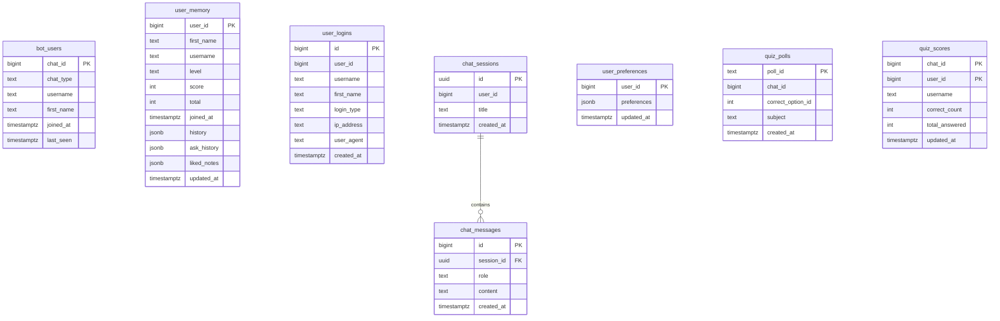

# Database & Schema Architecture — Brainy AI

Brainy AI utilizes a hosted **Supabase PostgreSQL** database for relational persistence, student session history, learning telemetry, and quiz performance metrics.

---

## 1. Database Entity-Relationship Diagram



---

## 2. Table Specifications

### A. `bot_users`
Stores student accounts created via Telegram bot interactions.

| Column | Type | Constraints | Description |
|---|---|---|---|
| `chat_id` | `bigint` | Primary Key | Unique Telegram numerical chat / user identifier |
| `chat_type` | `text` | Default: `'private'` | Type of chat (`private`, `group`, `supergroup`) |
| `username` | `text` | Nullable | Telegram username handle without `@` |
| `first_name` | `text` | Nullable | User display name |
| `joined_at` | `timestamptz`| Default: `now()` | Timestamp when student first started the bot |
| `last_seen` | `timestamptz`| Default: `now()` | Timestamp of most recent user interaction |

### B. `user_memory`
Stores personalized adaptive memory, solved problem history, and liked notes.

| Column | Type | Constraints | Description |
|---|---|---|---|
| `user_id` | `bigint` | Primary Key | Canonical user identifier |
| `first_name`| `text` | Default: `''` | User's display name |
| `username` | `text` | Default: `''` | User handle |
| `level` | `text` | Default: `'Beginner'` | Academic progression level |
| `score` | `int` | Default: `0` | Cumulative quiz points |
| `total` | `int` | Default: `0` | Total queries or questions completed |
| `joined_at` | `timestamptz`| Default: `now()` | Registration timestamp |
| `history` | `jsonb` | Default: `'[]'` | List of topics studied |
| `ask_history`| `jsonb` | Default: `'[]'` | List of solved query summaries |
| `liked_notes`| `jsonb` | Default: `'[]'` | Student notebook bookmark snippets |
| `updated_at`| `timestamptz`| Default: `now()` | Last memory modification timestamp |

### C. `user_logins`
Maintains audit logs and real telemetry for authentication events shown in `/admin`.

| Column | Type | Constraints | Description |
|---|---|---|---|
| `id` | `bigint` | Identity, PK | Auto-incrementing login log ID |
| `user_id` | `bigint` | Not Null | User ID who authenticated |
| `username` | `text` | Nullable | Username at login |
| `first_name`| `text` | Nullable | Display name at login |
| `login_type`| `text` | Default: `'web'` | Auth method (`web`, `student_pass`, `google`, `telegram`) |
| `ip_address`| `text` | Nullable | Transient IP recorded for rate limiting / audit |
| `user_agent`| `text` | Nullable | Browser User-Agent header |
| `created_at`| `timestamptz`| Default: `now()` | Login timestamp |

### D. `chat_sessions`
Groups conversation interactions into discrete study sessions.

| Column | Type | Constraints | Description |
|---|---|---|---|
| `id` | `uuid` | PK, Default: `uuid_generate_v4()` | Unique session UUID |
| `user_id` | `bigint` | Not Null | Owner's user ID |
| `title` | `text` | Default: `'New Study Session'` | Session title (SHA-256 masked in high-privacy mode) |
| `created_at`| `timestamptz`| Default: `now()` | Creation timestamp |

### E. `chat_messages`
Stores individual conversational bubbles exchanged within a session.

| Column | Type | Constraints | Description |
|---|---|---|---|
| `id` | `bigint` | Identity, PK | Auto-incrementing message ID |
| `session_id`| `uuid` | References `chat_sessions(id)` ON DELETE CASCADE | Parent conversation session |
| `role` | `text` | Check: `in ('user', 'assistant', 'system')` | Message sender role |
| `content` | `text` | Not Null | Markdown content of the message |
| `created_at`| `timestamptz`| Default: `now()` | Message timestamp |

### F. `user_preferences`
Stores custom themes, font selections, and interface settings.

| Column | Type | Constraints | Description |
|---|---|---|---|
| `user_id` | `bigint` | Primary Key | User identifier |
| `preferences`| `jsonb` | Default: `'{}'` | JSON object containing theme and typography settings |
| `updated_at`| `timestamptz`| Default: `now()` | Last preference modification timestamp |

### G. `quiz_polls` & `quiz_scores`
Tracks competitive quizzes and per-chat leaderboards.

* `quiz_polls`: Stores Telegram quiz poll IDs, correct option IDs, and academic subject.
* `quiz_scores`: Stores composite `(chat_id, user_id)` performance tallies, correct answer counts, and total questions attempted.

---

## 3. Database Indexes

To maintain sub-50ms query latency under production load, the schema configures specialized B-tree indexes:

```sql
create index if not exists idx_bot_users_last_seen on bot_users(last_seen desc);
create index if not exists idx_user_memory_user_id on user_memory(user_id);
create index if not exists idx_user_logins_user_id on user_logins(user_id);
create index if not exists idx_user_logins_created_at on user_logins(created_at desc);
create index if not exists idx_chat_sessions_user_id on chat_sessions(user_id);
create index if not exists idx_chat_sessions_created_at on chat_sessions(created_at desc);
create index if not exists idx_chat_messages_session_id on chat_messages(session_id);
create index if not exists idx_chat_messages_created_at on chat_messages(created_at asc);
```

---

## 4. Row Level Security (RLS) & Access Control

Brainy AI enforces strict Row Level Security across all 8 tables.

```sql
alter table bot_users enable row level security;
alter table user_memory enable row level security;
alter table user_logins enable row level security;
alter table chat_sessions enable row level security;
alter table chat_messages enable row level security;
alter table user_preferences enable row level security;
alter table quiz_polls enable row level security;
alter table quiz_scores enable row level security;
```

### Security Policy Principle
* Public / Anonymous (`anon`) role access is completely denied by default.
* All read and write operations are conducted exclusively through the Flask backend and Telegram daemon using the Supabase `service_role` key.
* This architecture ensures that no student client can issue direct, unverified SQL queries or bypass application-level rate limits and quotas.

---

## 5. Applying Migrations Safely

The complete database migration script is provided in [`supabase_schema.sql`](../supabase_schema.sql).

### Execution Steps
1. Log into your [Supabase Dashboard](https://supabase.com/dashboard).
2. Select your project and navigate to the **SQL Editor** tab on the left sidebar.
3. Open `supabase_schema.sql` from this repository, copy its contents, and paste into the editor.
4. Click **Run**.
5. The script is fully idempotent: it uses `CREATE TABLE IF NOT EXISTS`, `ALTER TABLE ADD COLUMN IF NOT EXISTS`, and `CREATE INDEX IF NOT EXISTS`. It can be safely executed against an existing database without overwriting or destroying existing data.
