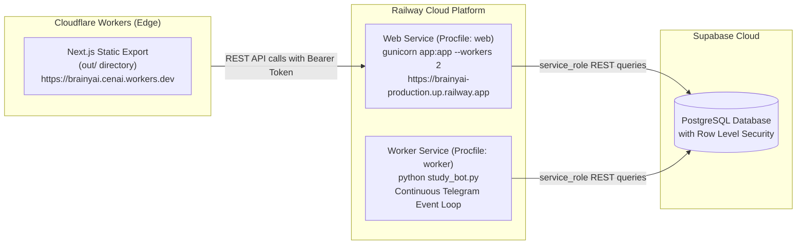

# Production Deployment Guide — Brainy AI

This guide covers the deployment workflow for **Brainy AI** across **Cloudflare Workers** (frontend static assets) and **Railway** (backend API gateway and Telegram bot worker).

---

## 1. Architecture Overview



---

## 2. Frontend Deployment: Cloudflare Workers

The frontend is built using Next.js with `output: 'export'` configured in `next.config.mjs`. It compiles into purely static HTML, CSS, JavaScript, and SVG assets in the `out/` directory, which Cloudflare Workers serves with zero cold-start latency.

### Configuration (`wrangler.jsonc`)
```jsonc
{
  "name": "brainy",
  "compatibility_date": "2024-09-23",
  "compatibility_flags": ["nodejs_compat"],
  "assets": {
    "directory": "./out",
    "binding": "ASSETS"
  },
  "workers_dev": true
}
```

### Build & Deploy Procedure
1. Verify that `NEXT_PUBLIC_API_URL` points to your deployed backend URL:
   ```bash
   # In .env or CI environment
   NEXT_PUBLIC_API_URL=https://brainyai-production.up.railway.app
   ```
2. Build the static production export:
   ```bash
   npm run build
   ```
3. Deploy to Cloudflare Workers using Wrangler:
   ```bash
   npm run deploy
   # Or directly:
   npx wrangler deploy
   ```
4. Confirm that the application is live at `https://<your-worker-subdomain>.workers.dev` (e.g., `https://brainyai.cenai.workers.dev`).

---

## 3. Backend Deployment: Railway

The backend runs as two separate services defined in the repository's [`Procfile`](../Procfile):
```text
web: gunicorn app:app --bind 0.0.0.0:$PORT --workers 2 --timeout 120
worker: python study_bot.py
```

### Step-by-Step Railway Setup
1. **Create a Railway Project**:
   - Go to [Railway Dashboard](https://railway.com) and click **New Project** > **Deploy from GitHub Repo**.
   - Select the `BrainyAi` repository.

2. **Configure Service 1: Web Gateway (Flask API)**:
   - In Settings, set the start command to:
     ```bash
     gunicorn app:app --bind 0.0.0.0:$PORT --workers 2 --timeout 120
     ```
   - Set the Healthcheck path to `/api/health`.
   - Add a public domain (e.g., `brainyai-production.up.railway.app`).

3. **Configure Service 2: Bot Daemon (Telegram Bot)**:
   - In the same project, click **New** > **GitHub Repo** > Select `BrainyAi`.
   - In Settings, set the start command to:
     ```bash
     python study_bot.py
     ```
   - This service runs as a background worker with no public HTTP endpoints.

4. **Add Backend Environment Variables in Railway**:
   Configure the following in the Railway dashboard for both services:

   | Variable | Value | Description |
   |---|---|---|
   | `PORT` | `5000` (auto-set by Railway) | Listening port |
   | `FLASK_SECRET_KEY` | Random 64-char hex string | HS256 signing secret |
   | `FRONTEND_URL` | `https://brainyai.cenai.workers.dev` | Frontend origin |
   | `ALLOWED_ORIGINS` | `https://brainyai.cenai.workers.dev,http://localhost:3000` | Permitted CORS origins |
   | `SUPABASE_URL` | `https://your-project.supabase.co` | Supabase URL |
   | `SUPABASE_KEY` | `your_service_role_key` | Supabase service_role key |
   | `TELEGRAM_TOKEN` | `your_telegram_bot_token` | Bot token from @BotFather |
   | `OWNER_ID` | `7544007323` | Bot owner user ID |
   | `ADMIN_USER_IDS` | `7544007323` | Users permitted in `/admin` |
   | `ADMIN_USERNAMES` | `shreyanshio,admin` | Admin usernames |
   | `GROQ_API_KEY` | `gsk_...` | Groq AI key |
   | `GEMINI_API_KEY` | `AIzaSy...` | Gemini AI key |
   | `OPENROUTER_API_KEY`| `sk-or-v1-...` | OpenRouter fallback key |
   | `TAVILY_API_KEY` | `tvly-...` | Tavily web search key |
   | `GLOBAL_MESSAGE_LIMIT`| `30` | 5-hour quota limit |
   | `QUOTA_WINDOW_HOURS`| `5` | Quota reset cycle (hours) |

---

## 4. CORS & Cross-Origin Configuration

Because the frontend and backend reside on different domains, cross-origin communication must be properly aligned:

1. **`ALLOWED_ORIGINS`**: Ensure your Cloudflare Workers domain (and any custom domains) are included in the backend's `ALLOWED_ORIGINS` comma-separated list.
2. **`Authorization: Bearer <token>`**: The frontend automatically passes the HS256 token in the `Authorization` header, completely bypassing third-party cookie restrictions enforced by modern browsers.

---

## 5. Health Checks & Verification

After deployment, verify the following endpoints:

1. **Backend Health Probe**:
   ```bash
   curl -i https://brainyai-production.up.railway.app/api/health
   # Expected: HTTP 200 OK, {"status": "ok", "service": "brainy-api"}
   ```
2. **Frontend Availability**:
   Visit `https://brainyai.cenai.workers.dev` in your browser. Verify that the login view renders and that authentication via 1-Click Student Pass immediately transitions to the chat workspace.
3. **Admin Verification**:
   Navigate to `/admin` while authenticated with an administrator account to verify database metrics and user list telemetry.

---

## 6. Rollback Considerations

* **Frontend**: Cloudflare Workers maintains versioned releases. In the Cloudflare dashboard, navigate to Workers & Pages > `brainy` > Deployments > Roll back to a previous successful deployment.
* **Backend**: Railway maintains git commit snapshots. Select any previous deployment card and click **Redeploy**.
* **Database**: `supabase_schema.sql` only adds columns and tables using `IF NOT EXISTS`. Schema rollbacks should be evaluated on an individual column basis.
